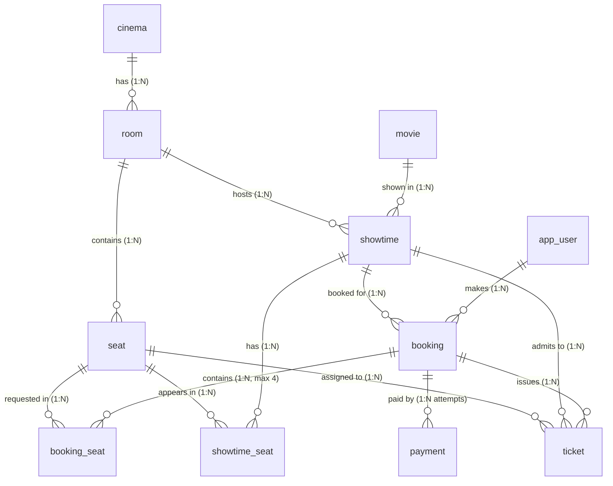
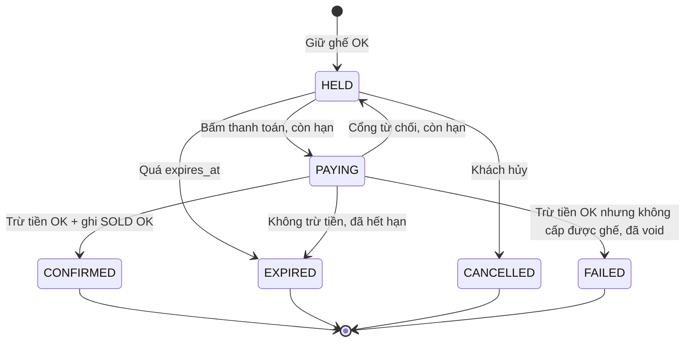

# Mô hình dữ liệu chi tiết (Data Model & Schema Dictionary)

Tài liệu này là **nguồn sự thật duy nhất (Single Source of Truth)** cho cấu trúc Database của dự án. Tất cả changelog Liquibase và Entity JPA phải tuân thủ nghiêm ngặt thiết kế dưới đây.

| Changelog | Nhóm bảng | Trạng thái |
|---|---|---|
| `001-user-catalog-tables.sql` | `app_user`, `movie`, `cinema`, `room`, `seat` | Đã áp dụng |
| `002-showtime-table.sql` | `showtime` (+ extension `btree_gist`) | Đã viết, chưa chạy trên Postgres |
| `003-showtime-seat-table.sql` | `showtime_seat` | Đã viết, chưa chạy trên Postgres |
| `004-booking-payment-ticket.sql` | `booking`, `booking_seat`, `payment`, `ticket` | Thiết kế (Phase 4) |

---

## 1. Quy ước thiết kế chung

* **Hệ quản trị CSDL:** PostgreSQL 17
* **Khóa chính (PK):** Chuẩn hóa cú pháp trực tiếp tại cột: `id BIGSERIAL PRIMARY KEY` (riêng bảng `seat` là `id SERIAL PRIMARY KEY`). Bảng nối và bảng nóng dùng khóa chính tổng hợp (`showtime_seat`, `booking_seat`).
* **Thời gian:**
  * CSDL luôn lưu chuẩn UTC bằng kiểu `TIMESTAMPTZ`.
  * **Múi giờ rạp:** Toàn bộ hệ thống là một chuỗi rạp duy nhất hoạt động tại Việt Nam, múi giờ hiển thị được coi là hằng số `Asia/Ho_Chi_Minh` (UTC+7) ở tầng ứng dụng (Application Layer). Không tạo thêm cột timezone ở bảng `cinema` để tránh dư thừa.
  * **Ai cập nhật `updated_at`:** Tầng Application (Spring Data JPA) quản lý tự động thông qua `@UpdateTimestamp` / `AuditingEntityListener`. Không dùng Trigger trong DB để giữ schema đơn giản và dễ test.
* **Tiền tệ:** Luôn dùng số nguyên `BIGINT` đơn vị VND (tránh sai số dấu phẩy động của `FLOAT`/`DOUBLE`).
* **Tính toàn vẹn & Lịch sử (Integrity & Soft Delete):**
  * **Không dùng `CASCADE` xóa hàng loạt:** Cấm xóa vật lý đối với `cinema`, `room`, `seat` bằng `ON DELETE RESTRICT` để bảo toàn lịch sử bán vé và báo cáo tài chính.
  * Dùng cờ `is_active BOOLEAN NOT NULL DEFAULT TRUE` để ngừng hoạt động một rạp/phòng/ghế mà không làm gãy các dữ liệu lịch sử liên kết (`ticket`, `showtime_seat`).
* **File lưu trữ (S3/MinIO):** Bảng CSDL chỉ lưu **S3 Object Key** (VD: `posters/2026/avatar2.jpg`), không lưu full domain URL hay presigned URL (vì presigned URL có hạn sử dụng, domain có thể đổi).
* **Trạng thái (status):** Bảng nhỏ và vừa dùng `VARCHAR(20)` + `CHECK` để dễ đọc khi debug. Riêng `showtime_seat` (~32 triệu dòng) dùng `SMALLINT` để tiết kiệm dung lượng.
* **Khóa ngoại không tự có index:** PostgreSQL tự tạo index cho `PRIMARY KEY` và `UNIQUE`, nhưng **không** tự tạo cho cột khóa ngoại. Mỗi cột FK phải được index (trực tiếp hoặc là cột đầu của một index khác), trừ khi có lý do ghi rõ. Thiếu index thì mỗi lần kiểm tra `RESTRICT` ở bảng cha sẽ quét toàn bộ bảng con.
* **Quy ước đặt tên Constraint & Index:**
  * **Khóa chính (PRIMARY KEY):** `pk_<tên_bảng>` (hoặc mặc định `<tên_bảng>_pkey` do PostgreSQL tự sinh).
  * **Ràng buộc kiểm tra (CHECK constraint - `chk_`):** `chk_<tên_bảng>_<tên_cột>`. Dùng để kiểm tra tính hợp lệ dữ liệu trực tiếp trong CSDL (giá trị enum, thời lượng số dương `duration_minutes > 0`...).
  * **Khóa ngoại (FOREIGN KEY - `fk_`):** `fk_<bảng_con>_<bảng_cha>`.
  * **Ràng buộc duy nhất (UNIQUE - `uq_`):** `uq_<tên_bảng>_<mô_tả>`.
  * **Chỉ mục (INDEX - `idx_`):** `idx_<tên_bảng>_<mô_tả>`.
  * **Ràng buộc loại trừ (EXCLUDE - `ex_`):** `ex_<tên_bảng>_<mô_tả>`.

---

## 2. Sơ đồ thực thể tổng quan (ERD)



> **Quan hệ `booking` và `payment`:** Là quan hệ **1-N (1:N payment attempts)**. Một đơn đặt vé có thể có nhiều lượt thanh toán: khi cổng thanh toán từ chối (không trừ tiền) mà hold còn hạn, booking quay về `HELD` và khách thử lại bằng một lượt mới (xem 5.1.1). Lượt bị timeout hoặc mất response **không** được thử lại cho tới khi đối soát xong, để tránh trừ tiền hai lần. DB bảo đảm mỗi booking có tối đa 1 lượt `PENDING` và tối đa 1 lượt `SUCCESS`.

> **Quan hệ của `showtime_seat`:** Các quan hệ với `showtime` và `seat` là quan hệ **logic**. Bảng này cố ý **không** có khóa ngoại vật lý (xem 4.2).

---

## 3. Phân hệ 1: Nhóm Catalog & Người dùng (Changelog 001)

### 3.1. Bảng `app_user` (Người dùng hệ thống)
* **Nghiệp vụ:** Khách hàng và Admin (UC1). Tên bảng là `app_user` vì `user` là từ khóa dành riêng trong PostgreSQL.

| Tên cột | Kiểu dữ liệu | Nullable | Mặc định | Ý nghĩa & Quy tắc |
| :--- | :--- | :---: | :--- | :--- |
| `id` | `BIGSERIAL` | No | Auto increment | Khóa chính |
| `email` | `VARCHAR(255)` | No | | Email đăng nhập, định danh duy nhất |
| `password_hash` | `VARCHAR(255)` | No | | Mật khẩu băm (BCrypt) |
| `full_name` | `VARCHAR(100)` | No | | Họ tên hiển thị |
| `role` | `VARCHAR(20)` | No | `'CUSTOMER'` | Phân quyền: `CUSTOMER`, `ADMIN` |
| `created_at` | `TIMESTAMPTZ` | No | `CURRENT_TIMESTAMP` | Thời điểm tạo tài khoản (UTC) |
| `updated_at` | `TIMESTAMPTZ` | No | `CURRENT_TIMESTAMP` | Thời điểm cập nhật cuối (UTC) |

* **Ràng buộc & Index:**
  * `PRIMARY KEY (id)`
  * `CONSTRAINT chk_app_user_role CHECK (role IN ('CUSTOMER', 'ADMIN'))`
  * `CREATE UNIQUE INDEX uq_app_user_email ON app_user (LOWER(email));` — Đảm bảo không phân biệt chữ hoa/thường (`A@x.com` và `a@x.com` cùng là một tài khoản).

---

### 3.2. Bảng `movie` (Phim)
* **Nghiệp vụ:** Danh mục phim (UC2, UC9). Trạng thái do Admin quản lý qua API (hoặc scheduled job tương lai).

| Tên cột | Kiểu dữ liệu | Nullable | Mặc định | Ý nghĩa & Quy tắc |
| :--- | :--- | :---: | :--- | :--- |
| `id` | `BIGSERIAL` | No | Auto increment | Khóa chính |
| `title` | `VARCHAR(255)` | No | | Tên phim |
| `duration_minutes` | `INT` | No | | Thời lượng chiếu (phút), dùng để tính giờ kết thúc suất |
| `release_date` | `DATE` | No | | Ngày công chiếu |
| `poster_key` | `VARCHAR(255)` | Yes | | S3 Object Key (VD: `posters/2026/avatar2.jpg`) |
| `status` | `VARCHAR(20)` | No | `'COMING_SOON'` | Trạng thái: `COMING_SOON`, `NOW_SHOWING`, `ENDED` |
| `created_at` | `TIMESTAMPTZ` | No | `CURRENT_TIMESTAMP` | Thời điểm tạo (UTC) |
| `updated_at` | `TIMESTAMPTZ` | No | `CURRENT_TIMESTAMP` | Thời điểm cập nhật cuối (UTC) |

* **Ràng buộc & Index:**
  * `PRIMARY KEY (id)`
  * `CONSTRAINT chk_movie_duration CHECK (duration_minutes > 0)`: Thời lượng phim bắt buộc phải là số dương.
  * `CONSTRAINT chk_movie_status CHECK (status IN ('COMING_SOON', 'NOW_SHOWING', 'ENDED'))`

---

### 3.3. Bảng `cinema` (Cụm rạp)
* **Nghiệp vụ:** Rạp chiếu phim trong chuỗi (UC3, UC9).

| Tên cột | Kiểu dữ liệu | Nullable | Mặc định | Ý nghĩa & Quy tắc |
| :--- | :--- | :---: | :--- | :--- |
| `id` | `BIGSERIAL` | No | Auto increment | Khóa chính |
| `name` | `VARCHAR(255)` | No | | Tên rạp (VD: "CGV Landmark 81") |
| `address` | `VARCHAR(500)` | No | | Địa chỉ rạp |
| `city` | `VARCHAR(100)` | No | | Thành phố / Tỉnh |
| `is_active` | `BOOLEAN` | No | `TRUE` | Trạng thái hoạt động (Soft delete) |
| `created_at` | `TIMESTAMPTZ` | No | `CURRENT_TIMESTAMP` | Thời điểm tạo (UTC) |
| `updated_at` | `TIMESTAMPTZ` | No | `CURRENT_TIMESTAMP` | Thời điểm cập nhật cuối (UTC) |

* **Ràng buộc & Index:**
  * `PRIMARY KEY (id)`

---

### 3.4. Bảng `room` (Phòng chiếu)
* **Nghiệp vụ:** Phòng chiếu thuộc rạp (UC3, UC9). Đã loại bỏ cột `total_seats` để tránh trùng lặp dữ liệu và lệch đồng bộ với bảng `seat`.

| Tên cột | Kiểu dữ liệu | Nullable | Mặc định | Ý nghĩa & Quy tắc |
| :--- | :--- | :---: | :--- | :--- |
| `id` | `BIGSERIAL` | No | Auto increment | Khóa chính |
| `cinema_id` | `BIGINT` | No | | Khóa ngoại trỏ về `cinema(id)` |
| `name` | `VARCHAR(100)` | No | | Tên phòng (VD: "Screen 1", "IMAX") |
| `is_active` | `BOOLEAN` | No | `TRUE` | Trạng thái hoạt động (Soft delete) |
| `created_at` | `TIMESTAMPTZ` | No | `CURRENT_TIMESTAMP` | Thời điểm tạo (UTC) |
| `updated_at` | `TIMESTAMPTZ` | No | `CURRENT_TIMESTAMP` | Thời điểm cập nhật cuối (UTC) |

* **Ràng buộc & Index:**
  * `PRIMARY KEY (id)`
  * `CONSTRAINT fk_room_cinema FOREIGN KEY (cinema_id) REFERENCES cinema (id) ON DELETE RESTRICT`
  * `CONSTRAINT uq_room_cinema_name UNIQUE (cinema_id, name)`: Một rạp không thể có 2 phòng trùng tên. Index của ràng buộc này có `cinema_id` ở cột đầu nên cũng là index cho FK `cinema_id`.

---

### 3.5. Bảng `seat` (Ghế ngồi)
* **Nghiệp vụ:** Ghế vật lý trong phòng (UC4, UC5).

| Tên cột | Kiểu dữ liệu | Nullable | Mặc định | Ý nghĩa & Quy tắc |
| :--- | :--- | :---: | :--- | :--- |
| `id` | **`SERIAL`** (`INT`) | No | Auto increment | Khóa chính (Tối đa 2.1 tỷ ghế) |
| `room_id` | `BIGINT` | No | | Khóa ngoại trỏ về `room(id)` |
| `seat_row` | `VARCHAR(10)` | No | | Hàng ghế (VD: 'A', 'B', 'VIP') |
| `seat_number` | `INT` | No | | Số ghế trong hàng (1, 2, 3...) |
| `seat_type` | `VARCHAR(20)` | No | `'STANDARD'` | Loại ghế: `STANDARD`, `VIP`, `COUPLE` |
| `is_active` | `BOOLEAN` | No | `TRUE` | Trạng thái ghế (ghế hỏng/bảo trì) |
| `created_at` | `TIMESTAMPTZ` | No | `CURRENT_TIMESTAMP` | Thời điểm tạo (UTC) |

* **Ràng buộc & Index:**
  * `PRIMARY KEY (id)`
  * `CONSTRAINT fk_seat_room FOREIGN KEY (room_id) REFERENCES room (id) ON DELETE RESTRICT`
  * `CONSTRAINT uq_seat_room_row_number UNIQUE (room_id, seat_row, seat_number)`: cũng là index cho FK `room_id`.
  * `CONSTRAINT chk_seat_type CHECK (seat_type IN ('STANDARD', 'VIP', 'COUPLE'))`

---

## 4. Phân hệ 2: Suất chiếu (Changelog 002, 003)

### 4.1. Bảng `showtime` (Suất chiếu) — Changelog 002
* **Nghiệp vụ:** Một lần chiếu một phim trong một phòng vào một khung giờ (UC3, UC9).

| Tên cột | Kiểu dữ liệu | Nullable | Mặc định | Ý nghĩa & Quy tắc |
| :--- | :--- | :---: | :--- | :--- |
| `id` | `BIGSERIAL` | No | Auto increment | Khóa chính |
| `movie_id` | `BIGINT` | No | | Khóa ngoại trỏ về `movie(id)` |
| `room_id` | `BIGINT` | No | | Khóa ngoại trỏ về `room(id)` |
| `start_time` | `TIMESTAMPTZ` | No | | Giờ bắt đầu chiếu (UTC) |
| `end_time` | `TIMESTAMPTZ` | No | | Giờ kết thúc (UTC). App tính `start_time + movie.duration_minutes` lúc tạo suất. **Không cộng thời gian dọn phòng** (đã chốt Q1) |
| `created_at` | `TIMESTAMPTZ` | No | `CURRENT_TIMESTAMP` | Thời điểm tạo (UTC) |
| `updated_at` | `TIMESTAMPTZ` | No | `CURRENT_TIMESTAMP` | Thời điểm cập nhật cuối (UTC) |

* **Ràng buộc & Index:**
  * `PRIMARY KEY (id)`
  * `CONSTRAINT fk_showtime_movie FOREIGN KEY (movie_id) REFERENCES movie (id) ON DELETE RESTRICT`
  * `CONSTRAINT fk_showtime_room FOREIGN KEY (room_id) REFERENCES room (id) ON DELETE RESTRICT`
  * `CONSTRAINT chk_showtime_time CHECK (end_time > start_time)`
  * `CREATE INDEX idx_showtime_movie_time ON showtime (movie_id, start_time);` — Phục vụ UC3 "các suất của phim X trong ngày Y". Cũng là index cho FK `movie_id`.
  * `CREATE INDEX idx_showtime_room_time ON showtime (room_id, start_time);` — Phục vụ lịch chiếu của một phòng (màn hình admin). Cũng là index cho FK `room_id`.
  * `CONSTRAINT ex_showtime_room_overlap EXCLUDE USING gist (room_id WITH =, tstzrange(start_time, end_time) WITH &&)` — Chặn hai suất trùng giờ trong cùng phòng ngay trong DB (đã chốt Q4). Cần extension `btree_gist`, bật ở một changeset riêng đặt **trước** changeset tạo bảng `showtime`:

    ```sql
    --changeset billy:002-01-enable-btree-gist
    --comment: btree_gist cho phép dùng toán tử = của BIGINT trong index GiST (cần cho ràng buộc EXCLUDE)
    CREATE EXTENSION IF NOT EXISTS btree_gist;
    --rollback DROP EXTENSION IF EXISTS btree_gist;
    ```

* **Giải thích:**
  * **Vì sao chặn trùng giờ bằng `EXCLUDE` trong DB, không chỉ kiểm tra ở app?** Kiểm tra ở app là kiểu "đọc rồi mới ghi": `SELECT` xem có suất trùng không, rồi `INSERT`. Hai admin tạo suất cùng lúc đều `SELECT` thấy trống và đều `INSERT` được. Ràng buộc `EXCLUDE` được Postgres kiểm tra nguyên tử lúc ghi, nên request thứ hai luôn bị chặn. Đây cùng một nguyên tắc với chống bán trùng ghế: quy tắc quan trọng phải được DB bảo đảm.
  * **Cách đọc ràng buộc:** "Không được có hai dòng mà `room_id` bằng nhau (`=`) **và** khoảng thời gian chồng lên nhau (`&&`)". GiST mặc định không hỗ trợ `=` trên `BIGINT`, nên mới cần `btree_gist`.
  * **Suất nối tiếp nhau được phép:** `tstzrange(a, b)` mặc định là khoảng `[a, b)`, tức gồm `a` nhưng không gồm `b`. Suất 19:00-21:00 và suất 21:00-23:00 không bị coi là trùng. Khớp với Q1 (không có thời gian dọn phòng).
  * **App vẫn nên kiểm tra trước** để trả thông báo dễ hiểu ("phòng đã có suất 19:00-21:00"). Ràng buộc DB là lưới an toàn cho trường hợp song song. Khi vi phạm, Postgres trả SQLSTATE `23P01` (`exclusion_violation`); app bắt lỗi này và trả HTTP `409 Conflict`.
  * **Chi phí:** mỗi lần `INSERT`/`UPDATE` giờ chiếu phải cập nhật thêm một index GiST. Với ~2.400 suất/ngày thì không đáng kể. Khi seed 216.000 suất ở Phase 3, script seed phải sinh giờ không chồng nhau, nếu không sẽ bị ràng buộc từ chối.
  * **Quyền:** từ PostgreSQL 13, `btree_gist` là extension "trusted", user có quyền `CREATE` trên database là bật được, không cần superuser. Image `postgres:17-alpine` và image Testcontainers đều có sẵn extension này.
  * **Hibernate `ddl-auto: validate`** không kiểm tra ràng buộc `EXCLUDE`, nên không cần khai báo gì trong entity.
  * **Vì sao lưu `end_time` dù tính được từ `duration_minutes`?** Có 3 lý do. Ràng buộc chống trùng giờ cần cột thật. Truy vấn "phòng có trống từ 19h đến 21h không" không phải join `movie`. Nếu admin sửa thời lượng phim sau này, các suất đã bán vé không bị đổi giờ kết thúc theo.
  * **Truy vấn theo ngày phải dùng khoảng thời gian, không dùng hàm trên cột:**

    ```sql
    -- Đúng: dùng được idx_showtime_movie_time, ranh giới ngày theo giờ Việt Nam
    WHERE movie_id = :movieId
      AND start_time >= '2026-11-04 00:00:00+07'
      AND start_time <  '2026-11-05 00:00:00+07'

    -- Sai: DATE() tính theo UTC (lệch 7 tiếng) và không dùng được index
    WHERE movie_id = :movieId AND DATE(start_time) = '2026-11-04'
    ```

  * **Lọc theo rạp:** `showtime` không có `cinema_id`, nên lọc theo rạp phải join `room`. Với một phim trong một ngày chỉ có vài trăm suất, join này rẻ. Nếu Phase 3 đo thấy chậm thì cân nhắc denormalize `cinema_id` vào `showtime` (một phòng không bao giờ đổi rạp nên dữ liệu không bị lệch).
  * **Đóng bán vé trước 15 phút:** không cần cột. Giờ đóng bán = `start_time - 15 phút`. Hạn giữ ghế không bao giờ vượt quá giờ đóng bán (`booking.expires_at`, 5.1), nên khi hết hạn giữ ghế thì cũng không còn thanh toán được.
  * **Xóa suất chiếu:** FK `booking.showtime_id ... RESTRICT` tự chặn việc xóa suất đã có người đặt. Suất chưa có booking thì xóa được, nhưng app phải xóa các dòng `showtime_seat` của suất đó **trong cùng transaction** vì `showtime_seat` không có FK để DB tự chặn hoặc tự dọn.

---

### 4.2. Bảng `showtime_seat` (Trạng thái ghế theo suất) — Changelog 003
* **Nghiệp vụ:** Mỗi dòng là một ghế trong một suất chiếu, kèm giá và trạng thái đã bán hay chưa (UC4, UC6, UC9). Khi admin tạo suất chiếu, app sinh sẵn một dòng cho mỗi ghế `is_active = TRUE` của phòng. **Đây là bảng nóng nhất và lớn nhất hệ thống** (~32 triệu dòng sau 90 ngày).

| Tên cột | Kiểu dữ liệu | Nullable | Mặc định | Ý nghĩa & Quy tắc |
| :--- | :--- | :---: | :--- | :--- |
| `showtime_id` | `BIGINT` | No | | Suất chiếu (tham chiếu logic tới `showtime.id`, không có FK) |
| `seat_id` | `INT` | No | | Ghế (tham chiếu logic tới `seat.id`, không có FK). Kiểu `INT` khớp với `seat.id SERIAL` |
| `status` | `SMALLINT` | No | `0` | `0` = AVAILABLE, `1` = SOLD. Không có trạng thái "đang giữ" |
| `price` | `BIGINT` | No | | Giá vé của ghế này trong suất này (VND) |

* **Ràng buộc & Index:**
  * `PRIMARY KEY (showtime_id, seat_id)` — Câu truy vấn sơ đồ ghế `WHERE showtime_id = ?` dùng được cột đầu của PK, nên **không cần thêm index nào khác**.
  * `CONSTRAINT chk_showtime_seat_status CHECK (status IN (0, 1))`
  * `CONSTRAINT chk_showtime_seat_price CHECK (price > 0)` `[INFERRED — verify]`: requirements không nói về vé 0 đồng; giá 0 nhiều khả năng là lỗi nhập liệu.
  * **Không có khóa ngoại, không có `created_at`/`updated_at`** (cố ý, xem giải thích).

* **Giải thích:**
  * **Vì sao chỉ có 2 trạng thái?** Trạng thái "đang giữ" nằm ở Redis với TTL 8 phút. Nếu lưu ở đây, mỗi lần giữ hoặc nhả ghế là một lần ghi Postgres, và phải có job dọn các hold hết hạn. Postgres chỉ ghi nhận sự thật lâu dài: ghế đã bán hay chưa.
  * **Lưới an toàn lớp 1 chống bán trùng** nằm ở câu `UPDATE` có điều kiện khi thanh toán:

    ```sql
    UPDATE showtime_seat
       SET status = 1
     WHERE showtime_id = :showtimeId
       AND seat_id IN (:seatIds)
       AND status = 0;
    -- App kiểm tra: số dòng bị ảnh hưởng phải bằng số ghế. Thiếu thì rollback + void thanh toán.
    ```

    Hai transaction cùng update một dòng sẽ phải chờ nhau (row lock). Transaction đến sau đọc lại thấy `status = 1`, điều kiện `status = 0` sai, nên không cập nhật được dòng đó.
  * **Vì sao không có khóa ngoại?** Mỗi dòng insert có FK thì Postgres phải tra bảng cha để kiểm tra. Với 32 triệu dòng seed và 150 dòng mỗi lần tạo suất, bỏ FK giúp ghi nhanh hơn. Cái giá là DB không tự chặn dòng mồ côi: app phải bảo đảm `showtime_id` và `seat_id` tồn tại, và phải tự dọn khi xóa suất. Đây là đánh đổi nên đo lại ở Phase 3 (seed có FK và không FK).
  * **Vì sao lưu `price` ở đây?** Admin nhập giá theo loại ghế khi tạo suất (VD: `STANDARD = 90.000`, `VIP = 120.000`, `COUPLE = 200.000`), app chép giá vào từng dòng. Truy vấn sơ đồ ghế có giá luôn mà không phải join thêm bảng giá, và giá của suất không đổi nếu bảng giá chung thay đổi sau đó. Cái giá là thêm 8 byte mỗi dòng (ước tính bên dưới).
  * **Ước tính kích thước một dòng** `[INFERRED — verify bằng pg_total_relation_size ở Phase 3]`:
    * Dữ liệu: `showtime_id` 8 + `seat_id` 4 + `status` 2 + 2 byte đệm để `price` bắt đầu ở bội số của 8 + `price` 8 = 24 byte.
    * Header của tuple 24 byte, con trỏ dòng trong page 4 byte: tổng khoảng 52 byte/dòng, tức khoảng 1,7 GB cho 32,4 triệu dòng.
    * Index PK: khoảng 28 byte/entry, tức khoảng 0,9-1 GB.
    * Tổng khoảng 2,6-2,8 GB, khớp với ước tính ở mục 7. Bỏ `price` thì dữ liệu còn 16 byte, tiết kiệm khoảng 260 MB.
  * **Ghế bị ngừng hoạt động sau khi đã tạo suất:** dòng `showtime_seat` cũ vẫn còn và vẫn bán được. Nếu cần chặn thì admin phải xử lý riêng (ngoài phạm vi MVP1).
  * **Thí nghiệm `fillfactor` ở Phase 3:** `status` không nằm trong index nào, nên update `status` có thể là HOT update (không phải ghi lại index) nếu page còn chỗ trống. Để mặc định `fillfactor = 100` trước, đo, rồi thử `90`.

---

## 5. Phân hệ 3: Đặt vé, Thanh toán, Vé (Changelog 004)

### 5.1. Bảng `booking` (Đơn đặt vé)
* **Nghiệp vụ:** Một lần khách giữ từ 1 đến 4 ghế trong một suất chiếu, và đi tiếp tới thanh toán (UC5, UC6, UC7, UC8). Vòng đời theo state machine ở mục 5.1.1. Bản này **thay thế** state machine ở `cinema-booking-progress.md` mục 8 (bổ sung `PAYING → HELD`, `PAYING → EXPIRED` và thu hẹp nghĩa của `FAILED`).

| Tên cột | Kiểu dữ liệu | Nullable | Mặc định | Ý nghĩa & Quy tắc |
| :--- | :--- | :---: | :--- | :--- |
| `id` | `BIGSERIAL` | No | Auto increment | Khóa chính |
| `user_id` | `BIGINT` | No | | Khóa ngoại trỏ về `app_user(id)` |
| `showtime_id` | `BIGINT` | No | | Khóa ngoại trỏ về `showtime(id)` |
| `hold_id` | `UUID` | No | | Giá trị đặt vào các key Redis `hold:{showtimeId}:{seatId}`. Dùng để chứng minh "hold này là của tôi" |
| `status` | `VARCHAR(20)` | No | `'HELD'` | `HELD`, `PAYING`, `CONFIRMED`, `EXPIRED`, `CANCELLED`, `FAILED` |
| `total_amount` | `BIGINT` | No | | Tổng tiền (VND) = tổng `booking_seat.price`, chốt lúc giữ ghế |
| `expires_at` | `TIMESTAMPTZ` | No | | Hạn giữ ghế (UTC) = `min(thời điểm giữ + 8 phút, showtime.start_time - 15 phút)`. Xem 5.1.4 |
| `idempotency_key` | `VARCHAR(64)` | No | | Header `Idempotency-Key` của request giữ ghế |
| `created_at` | `TIMESTAMPTZ` | No | `CURRENT_TIMESTAMP` | Thời điểm tạo (UTC) |
| `updated_at` | `TIMESTAMPTZ` | No | `CURRENT_TIMESTAMP` | Thời điểm cập nhật cuối (UTC) |

* **Ràng buộc & Index:**
  * `PRIMARY KEY (id)`
  * `CONSTRAINT fk_booking_app_user FOREIGN KEY (user_id) REFERENCES app_user (id) ON DELETE RESTRICT`
  * `CONSTRAINT fk_booking_showtime FOREIGN KEY (showtime_id) REFERENCES showtime (id) ON DELETE RESTRICT`
  * `CONSTRAINT chk_booking_status CHECK (status IN ('HELD', 'PAYING', 'CONFIRMED', 'EXPIRED', 'CANCELLED', 'FAILED'))`
  * `CONSTRAINT chk_booking_total_amount CHECK (total_amount > 0)`
  * `CONSTRAINT uq_booking_hold_id UNIQUE (hold_id)`
  * `CONSTRAINT uq_booking_user_idempotency UNIQUE (user_id, idempotency_key)`
  * `CREATE INDEX idx_booking_user_created ON booking (user_id, created_at DESC);` — UC7 lịch sử đặt vé, mới nhất trước. Cũng là index cho FK `user_id`.
  * `CREATE INDEX idx_booking_showtime ON booking (showtime_id);` — Index cho FK. Thiếu nó thì mỗi lần thử xóa một suất chiếu, Postgres phải quét toàn bộ ~9 triệu dòng `booking` để kiểm tra `RESTRICT`.
  * `CREATE INDEX idx_booking_held_expires ON booking (expires_at) WHERE status = 'HELD';` — **Partial index** cho job `@Scheduled` chuyển `HELD` quá hạn sang `EXPIRED`.
  * `CREATE INDEX idx_booking_paying_updated ON booking (updated_at) WHERE status = 'PAYING';` — Partial index cho job đối soát tìm booking kẹt ở `PAYING` (xem 5.1.3).
  * `CREATE UNIQUE INDEX uq_booking_user_showtime_active ON booking (user_id, showtime_id) WHERE status IN ('HELD', 'PAYING');` — (đã chốt Q5) Mỗi khách có tối đa **một** booking đang hoạt động trong một suất. Dùng để tìm lại booking khi khách reload (5.1.2), và chặn việc lách giới hạn 4 ghế bằng cách tạo nhiều booking.

* **Giải thích:**
  * **Vì sao idempotency key UNIQUE theo user, không UNIQUE toàn cục?** Key do client sinh. Nếu unique toàn cục, user A gửi trùng key của user B sẽ đụng bản ghi của B, và code sơ suất có thể trả đơn của B cho A. Ghép với `user_id` thì mỗi user có không gian key riêng.
  * **Gửi lặp request giữ ghế:** request thứ hai `INSERT` vấp `uq_booking_user_idempotency`. App bắt lỗi này, đọc booking cũ theo `(user_id, idempotency_key)` và trả lại đúng kết quả cũ, không chạy Lua lần nữa.
  * **Vì sao partial index?** Job dọn chỉ quan tâm các dòng `HELD`. Phần lớn dòng trong bảng ở trạng thái cuối (`CONFIRMED`, `EXPIRED`...), nên index chỉ chứa dòng `HELD` nhỏ hơn nhiều so với index trên cả bảng. Dòng chuyển sang trạng thái khác sẽ không còn khớp điều kiện của index; các entry cũ được dọn qua vacuum.
  * **Chuyển trạng thái an toàn khi chạy song song** luôn dùng `UPDATE` có điều kiện trên trạng thái cũ:

    ```sql
    UPDATE booking SET status = 'PAYING', updated_at = now()
     WHERE id = :id AND status = 'HELD'
       AND expires_at > now() + interval '30 seconds';
    -- 0 dòng bị ảnh hưởng: request khác đã chuyển trạng thái,
    -- hoặc thời gian giữ ghế còn dưới 30 giây (không đủ để thanh toán xong, xem 5.1.4).
    ```

    Câu này trả lời câu hỏi "hai request thanh toán cùng một booking đến cùng lúc": chỉ một request chuyển được `HELD → PAYING`, request kia nhận 0 dòng và dừng.
  * **`expires_at` trong Postgres và TTL trong Redis** cùng mô tả một hạn. Redis tự nhả ghế; `expires_at` cho phép job và "phát hiện lười" biết booking đã hết hạn kể cả khi Redis mất dữ liệu.
  * **`expires_at` không bao giờ được gia hạn**, kể cả khi khách thanh toán lại hoặc đang thanh toán (requirements: không gia hạn). TTL của key Redis cũng không được kéo dài khi booking sang `PAYING`. Mọi lần thử thanh toán phải nằm trong thời gian giữ ghế ban đầu.

#### 5.1.1. State machine (đã chốt Q2)



| Từ | Sang | Điều kiện | Ai kích hoạt |
|---|---|---|---|
| (mới) | `HELD` | Lua giữ ghế thành công | API giữ ghế |
| `HELD` | `PAYING` | Còn **ít nhất 30 giây** (`expires_at > now() + 30 giây`) và mọi key Redis còn, đúng `hold_id` | API thanh toán |
| `HELD` | `EXPIRED` | `expires_at <= now()` | Job nền, hoặc phát hiện lười |
| `HELD` | `CANCELLED` | Khách bỏ đặt vé | API hủy |
| `PAYING` | `HELD` | Cổng thanh toán **trả lời rõ ràng** là từ chối (không trừ tiền) và `expires_at > now()` | API thanh toán, hoặc job đối soát |
| `PAYING` | `EXPIRED` | Chắc chắn không trừ tiền, và `expires_at <= now()` | API thanh toán, hoặc job đối soát |
| `PAYING` | `CONFIRMED` | Có 1 `payment` `SUCCESS` và ghi `SOLD` thành công | API thanh toán, hoặc job đối soát |
| `PAYING` | `FAILED` | Có `payment` `SUCCESS` nhưng ghi `SOLD` thất bại; đã void, `payment → VOIDED` | API thanh toán, hoặc job đối soát |

**Nghĩa của 4 trạng thái cuối** (để báo cáo và đối soát không phải đoán):

| Trạng thái | Tiền của khách | Vé |
|---|---|---|
| `CONFIRMED` | Đã trừ, đúng 1 `payment` `SUCCESS` | Có |
| `EXPIRED` | Không trừ | Không |
| `CANCELLED` | Không trừ | Không |
| `FAILED` | Đã trừ rồi được hoàn qua void (`payment` `VOIDED`) | Không |

`FAILED` chỉ dùng cho đúng một trường hợp: đã trừ tiền nhưng không cấp được ghế. Thanh toán bị từ chối **không** làm booking `FAILED`, mà đưa về `HELD` (còn hạn) hoặc `EXPIRED` (hết hạn).

**Vì sao chọn phương án này cho Q2?** Có 3 hướng đã cân nhắc:

| Phương án | Cách làm | Đánh giá |
|---|---|---|
| A. Mỗi booking 1 lượt thanh toán | Bị từ chối thì booking `FAILED`, khách phải giữ ghế lại từ đầu | Đơn giản, nhưng khi nhả hold thì người khác có thể giành mất ghế chỉ vì khách nhập sai thẻ. Bảng `payment` 1:N trở nên thừa |
| **B. Cho thử lại trong thời gian hold (chọn)** | Bị từ chối thì `PAYING → HELD`, khách thử lại với lượt `payment` mới, vẫn giữ nguyên ghế và hạn cũ | Trải nghiệm tốt, khớp với 1:N. Thêm 1 chuyển trạng thái và cần chặn 2 lượt chạy song song (bên dưới) |
| C. Cho thử lại cả khi timeout | Mất response thì cho khách bấm trả tiền lại ngay | **Loại.** Lượt đầu có thể đã trừ tiền, cho trả lại sẽ trừ hai lần |

**Ba quy tắc giữ phương án B an toàn:**

1. **Chỉ quay về `HELD` khi chắc chắn chưa trừ tiền.** Timeout hoặc mất response nghĩa là "chưa biết", booking giữ nguyên `PAYING` và khách **không** được thử lại cho tới khi đối soát xong (5.1.3).
2. **Mỗi booking có tối đa 1 lượt đang chạy:** `HELD → PAYING` dùng `UPDATE` có điều kiện, và `payment` có partial unique index `WHERE status = 'PENDING'` (5.3).
3. **Mỗi lượt thử là một idempotency key mới.** Bấm lại cùng một lượt (gửi lặp request) dùng lại key cũ và nhận lại kết quả cũ. Thử lại sau khi bị từ chối thì FE sinh key mới.

```sql
-- Cổng từ chối: quay về HELD nếu còn hạn
UPDATE booking SET status = 'HELD', updated_at = now()
 WHERE id = :id AND status = 'PAYING' AND expires_at > now();
-- 0 dòng: đã hết hạn, chuyển sang EXPIRED
UPDATE booking SET status = 'EXPIRED', updated_at = now()
 WHERE id = :id AND status = 'PAYING';
```

#### 5.1.2. Khách reload trang hoặc quay lại (đã chốt Q3)

**Có, khách tiếp tục được.** Booking nằm trong Postgres, không nằm ở trình duyệt, nên reload không mất gì. FE chỉ cần biết `booking.id` (đặt trong URL, VD `/bookings/123/checkout`). Nếu mất cả URL thì gọi API tìm booking đang hoạt động theo `(user_id, showtime_id)`, dùng index `uq_booking_user_showtime_active`.

* **Bảo mật:** API luôn kiểm tra `booking.user_id` bằng user trong JWT. Nếu không kiểm tra, ai đoán được `id` cũng xem hoặc trả tiền được đơn của người khác (lỗi IDOR). Không trả `hold_id` ra FE, vì nó là bằng chứng sở hữu hold trong Redis.
* **Kết quả khi load lại, theo trạng thái:**

| Trạng thái khi load | Điều kiện | Server làm gì | FE hiển thị |
|---|---|---|---|
| `HELD` | `expires_at > now()` | Trả ghế, giá, `expires_at`, số giây còn lại | Tiếp tục màn thanh toán, đếm ngược **từ `expires_at`**, không đếm lại từ 8 phút |
| `HELD` | `expires_at <= now()` | Phát hiện lười: `UPDATE ... SET status = 'EXPIRED' WHERE id = :id AND status = 'HELD'` | "Hết thời gian giữ ghế", cho chọn ghế lại |
| `PAYING` | | Không cho thanh toán lượt mới | "Đang xử lý thanh toán", FE hỏi lại trạng thái mỗi vài giây |
| `CONFIRMED` | | Trả vé | Hiển thị vé QR |
| `EXPIRED` / `CANCELLED` / `FAILED` | | Trả trạng thái | Thông báo tương ứng (`FAILED`: "Đã hoàn tiền, vui lòng đặt lại") |

* **Số giây còn lại do server tính** (`expires_at - now()` theo giờ server). Đồng hồ máy khách có thể lệch, nên FE không tự tính từ giờ của mình.
* **Khách chọn ghế lại khi đang có booking `HELD`/`PAYING` trong cùng suất** (đổi ghế, hoặc mở suất đó trên thiết bị thứ hai): với `uq_booking_user_showtime_active`, `INSERT` booking mới bị chặn. API trả `409` kèm `id` và danh sách ghế của booking đang có. **FE coi `409` là chuyển hướng, không phải lỗi** (5.1.5). Nếu booking cũ đã quá hạn mà job chưa kịp chuyển `EXPIRED`, API chạy phát hiện lười trước rồi mới `INSERT`.
* **"Đổi ghế" = hủy booking cũ (UC8) rồi chọn lại.** Không hỗ trợ sửa ghế ngay trong booking ở MVP1, vì muốn vậy phải viết thêm Lua để đổi ghế nguyên tử. Khi hủy, ghế cũ được nhả và người khác có thể giành, nên FE phải cảnh báo trước.

#### 5.1.3. Hết thời gian thì "clear" như thế nào (đã chốt Q3)

**"Clear" nghĩa là nhả ghế và chuyển trạng thái, không xóa dòng.** Booking hết hạn vẫn nằm trong bảng ở trạng thái `EXPIRED` để giữ lịch sử và đối soát.

**Trường hợp 1: booking `HELD` quá hạn** (khách không bấm thanh toán). Clear được ngay vì chắc chắn chưa trừ tiền.

* Redis tự xóa key hold khi hết TTL, nên người khác giữ được ghế **ngay lập tức**.
* Postgres chuyển `HELD → EXPIRED` bằng 2 cách: phát hiện lười khi có ai đọc booking, và job `@Scheduled` chạy mỗi 30 giây (requirements yêu cầu chuyển `EXPIRED` trong vòng 1 phút):

  ```sql
  UPDATE booking SET status = 'EXPIRED', updated_at = now()
   WHERE status = 'HELD' AND expires_at < now();
  ```

**Trường hợp 2: booking kẹt ở `PAYING`** (mất response từ cổng thanh toán, hoặc app chết). **Không được clear ngay**, vì có thể tiền đã bị trừ. Xử lý theo 2 tầng:

* **Tầng 1: tra lại ngay trong request thanh toán.** Khi gọi trừ tiền bị timeout, chính request đó tra trạng thái giao dịch ở cổng theo idempotency key, tối đa 2 lần (thông số ở 5.1.4). Có kết quả thì xử lý luôn theo bảng bên dưới, khách nhận kết quả sau khoảng 15-25 giây thay vì phải chờ job. Vẫn không có kết quả thì request trả "đang xác nhận thanh toán" và để tầng 2 xử lý.
* **Tầng 2: job đối soát (lưới an toàn)**, cho trường hợp tầng 1 không có kết quả hoặc app chết giữa chừng. Job chạy mỗi 30 giây, lấy các booking `PAYING` có `updated_at` cũ hơn 60 giây (giải thích ở 5.1.4), hỏi cổng thanh toán trạng thái thật của lượt `PENDING` theo idempotency key, rồi xử lý:

Cả hai tầng dùng chung bảng xử lý:

| Cổng thanh toán trả lời | `payment` | `booking` |
|---|---|---|
| Từ chối / không có giao dịch | `PENDING → FAILED` | `PAYING → HELD` nếu còn hạn, `PAYING → EXPIRED` nếu hết hạn |
| Đã trừ tiền, ghế còn trống | `PENDING → SUCCESS` | Chạy bước cấp ghế (mục 6, bước 3c) → `CONFIRMED` |
| Đã trừ tiền, ghế đã bị người khác mua | `SUCCESS → VOIDED` (sau khi void) | `PAYING → FAILED` |
| Chưa trả lời được (cổng đang lỗi) | Giữ `PENDING` | Giữ `PAYING`, lần chạy sau hỏi lại |

* **Vì sao vẫn cấp vé dù đã quá 8 phút?** Khách đã trả tiền trong hạn, chỉ là hệ thống chậm xác nhận. Nếu ghế vẫn còn trống thì cấp vé là kết quả tốt nhất cho khách. Nếu trong lúc đó người khác đã giữ ghế ở Redis, lưới an toàn `UPDATE ... WHERE status = 0` vẫn bảo đảm chỉ một người được `SOLD`, người còn lại được void.
* **`HELD → PAYING` và `INSERT payment (PENDING)` phải nằm trong cùng một transaction.** Nhờ vậy booking `PAYING` luôn có một lượt `payment` đi kèm để job đối soát dựa vào.
* **Yêu cầu cho cổng thanh toán giả lập (Phase 4c):** phải có API tra trạng thái giao dịch theo idempotency key, và API void theo `provider_txn_id`. Không có API tra trạng thái thì không thể đối soát.

#### 5.1.4. Các mốc thời gian

**Đã chốt (Q6, Q8 — 2026-11-04).** Hai mốc đầu lấy từ requirements. Các mốc còn lại là quyết định thiết kế, đặt trong `application.yaml` để chỉnh được mà không sửa code. Khi chỉnh phải giữ đúng 2 ràng buộc ở cuối bảng.

| Mốc | Giá trị | Nghĩa là gì | Vì sao chọn số này |
|---|---|---|---|
| Thời gian giữ ghế | 8 phút, nhưng không quá giờ đóng bán | `expires_at = min(now + 8 phút, start_time - 15 phút)`. TTL key Redis = số giây từ lúc giữ tới `expires_at` | 8 phút: `[FROM SOURCE: 01-requirements.md mục 4]`. Giới hạn bởi giờ đóng bán để đồng hồ đếm ngược luôn hiện đúng thời gian thật |
| Đóng bán vé | 15 phút trước giờ chiếu | Sau mốc này không giữ ghế và không thanh toán được | `[FROM SOURCE: 01-requirements.md mục 4]` |
| Thời gian còn lại tối thiểu | 30 giây | Còn dưới 30 giây thì **không cho giữ ghế** (suất sắp đóng bán) và **không cho bắt đầu thanh toán** | Bằng thời gian tối đa của một request thanh toán (dòng dưới). Bắt đầu thanh toán khi còn ≥ 30 giây thì gần như luôn có kết quả trước khi hold hết hạn, tránh trường hợp trừ tiền rồi phải hoàn vì ghế bị người khác mua |
| Timeout gọi trừ tiền | 10 giây | App chờ cổng trả lời lệnh trừ tiền tối đa bao lâu. Quá thời gian thì coi là "chưa biết kết quả" | Đủ dài cho độ trễ giả lập, đủ ngắn để khách không chờ quá lâu |
| Tra lại trạng thái ngay (tầng 1) | Tối đa 2 lần, chờ 5 giây trước mỗi lần, mỗi lần timeout 3 giây | Sau khi timeout, request tự hỏi lại cổng "giao dịch này đã trừ tiền chưa?" | Thời gian tối đa của một request thanh toán: 10 + (5 + 3) × 2 = **26 giây**, làm tròn thành 30 giây |
| Chu kỳ job hết hạn | 30 giây | Bao lâu job chạy một lần để chuyển `HELD` quá hạn sang `EXPIRED` | Requirements yêu cầu chuyển `EXPIRED` trong vòng 1 phút. Chạy mỗi 30 giây thì trễ nhiều nhất khoảng 30 giây cộng thời gian chạy job |
| Ngưỡng "kẹt `PAYING`" | 60 giây | Booking `PAYING` không đổi trong bao lâu thì job đối soát mới xử lý | Lớn hơn hẳn thời gian tối đa của request (26 giây), nên job không chen vào request vẫn đang chạy |
| Chu kỳ job đối soát | 30 giây | Bao lâu job đối soát chạy một lần | Booking kẹt (hiếm, chủ yếu khi app chết) được xử lý trong khoảng 60-90 giây |

**Hai ràng buộc khi chỉnh số:**

1. Thời gian còn lại tối thiểu ≥ thời gian tối đa của request thanh toán (timeout + các lần tra lại).
2. Ngưỡng kẹt `PAYING` > thời gian tối đa của request thanh toán.

* **Job hết hạn không quyết định lúc nào ghế được nhả.** Ghế được nhả ngay khi key Redis hết TTL. Job chỉ cập nhật trạng thái trong Postgres để lịch sử và màn hình của khách đúng.
* **Ví dụ với booking giữ ghế lúc 19:00:00** (suất chiếu 21:00, nên giờ đóng bán 20:45 không ảnh hưởng, `expires_at` = 19:08:00):
  * 19:07:20: khách bấm thanh toán, còn 40 giây nên được phép. Cổng không trả lời.
  * 19:07:30: hết timeout 10 giây. Request tra lại lúc 19:07:35 (cổng trả lời: đã trừ tiền), cấp vé luôn, booking `CONFIRMED` lúc khoảng 19:07:38. Hold vẫn còn hạn nên ghế không bị ai giành.
  * Nếu khách bấm lúc 19:07:40 (còn 20 giây): server từ chối, FE hiện "Không đủ thời gian thanh toán". Khách không bị trừ tiền.
  * Nếu khách không bấm gì: 19:08:00 key Redis hết hạn, người khác giữ được ghế ngay. Trong khoảng 19:08:00-19:08:30, job chuyển booking sang `EXPIRED`.
* **Ví dụ giữ ghế sát giờ đóng bán** (suất chiếu 20:00, đóng bán 19:45): khách giữ ghế lúc 19:43:00 thì `expires_at` = 19:45:00, đồng hồ hiện **2 phút**, không phải 8 phút. Khách giữ ghế lúc 19:44:45 (còn 15 giây) thì bị từ chối: "Suất này sắp đóng bán vé".

#### 5.1.5. Hành vi hiển thị cho khách (đã chốt Q8)

| Tình huống | Server trả | FE hiển thị |
|---|---|---|
| Đang giữ ghế | `expires_at`, số giây còn lại | Đồng hồ đếm ngược. Cảnh báo ở mốc **còn 2 phút** và **còn 1 phút** |
| Còn dưới 30 giây | Từ chối bắt đầu thanh toán (`409`) | Nút "Thanh toán" bị làm mờ: "Không đủ thời gian thanh toán, vui lòng chọn lại ghế" |
| Đang thanh toán, chờ cổng (tầng 1) | Request chưa trả về | "Đang xác nhận thanh toán. Vui lòng không thanh toán lại, bạn sẽ không bị trừ tiền hai lần" |
| Tầng 1 không có kết quả | `202`, booking `PAYING` | Như trên, kèm "Kết quả sẽ hiện trong Lịch sử đặt vé". FE hỏi lại trạng thái mỗi vài giây |
| Cổng từ chối, còn ≥ 30 giây | Booking về `HELD` | "Thẻ bị từ chối", cho thử lại với ghế và đồng hồ giữ nguyên |
| Cổng từ chối, còn < 30 giây | Booking về `HELD` (hoặc `EXPIRED` nếu đã hết hạn) | "Thẻ bị từ chối. Thời gian giữ ghế không đủ để thử lại, vui lòng chọn lại ghế" |
| `FAILED` (đã trừ tiền, không cấp được ghế) | Booking `FAILED` | "Không thể giữ ghế cho bạn. Giao dịch đã được hủy, bạn sẽ không bị mất tiền" |
| Giữ ghế khi đã có booking đang hoạt động | `409` + `id` và ghế của booking cũ | "Bạn đang giữ A1, A2 cho suất này" + nút **Tiếp tục thanh toán** và **Đổi ghế** |
| Bấm "Đổi ghế" | | Hỏi xác nhận: "Ghế A1, A2 sẽ được nhả, người khác có thể chọn". Đồng ý thì hủy booking (UC8) rồi về sơ đồ ghế |
| Giữ ghế thất bại vì ghế bị người khác giữ | `409` + danh sách ghế bị chiếm | Tô lại các ghế đó trên sơ đồ ngay, không chỉ báo lỗi chung |
| Suất sắp đóng bán (còn < 30 giây) | Từ chối giữ ghế | "Suất này sắp đóng bán vé" |

* **Không làm ở MVP1:** kéo dài TTL Redis khi đang thanh toán (trái với "không gia hạn" trong requirements), sửa ghế ngay trong booking, cập nhật sơ đồ ghế realtime (để MVP2).

---

### 5.2. Bảng `booking_seat` (Ghế trong đơn đặt vé)
* **Nghiệp vụ:** Các ghế mà một booking đã giữ, kèm giá chốt tại thời điểm giữ (UC5).

| Tên cột | Kiểu dữ liệu | Nullable | Mặc định | Ý nghĩa & Quy tắc |
| :--- | :--- | :---: | :--- | :--- |
| `booking_id` | `BIGINT` | No | | Khóa ngoại trỏ về `booking(id)` |
| `seat_id` | `INT` | No | | Khóa ngoại trỏ về `seat(id)` |
| `price` | `BIGINT` | No | | Giá chép từ `showtime_seat.price` lúc giữ ghế (VND) |

* **Ràng buộc & Index:**
  * `PRIMARY KEY (booking_id, seat_id)` — Một booking không chứa cùng một ghế hai lần. Cũng là index cho FK `booking_id`.
  * `CONSTRAINT fk_booking_seat_booking FOREIGN KEY (booking_id) REFERENCES booking (id) ON DELETE RESTRICT`
  * `CONSTRAINT fk_booking_seat_seat FOREIGN KEY (seat_id) REFERENCES seat (id) ON DELETE RESTRICT`
  * `CONSTRAINT chk_booking_seat_price CHECK (price > 0)`
  * Không index riêng cho FK `seat_id`: `seat` dùng soft delete nên gần như không bao giờ xóa, kiểm tra `RESTRICT` hiếm khi chạy.

* **Giải thích:**
  * **Vì sao cần bảng này khi đã có `showtime_seat` và Redis?** Lúc giữ ghế, ghế chưa bán nên `showtime_seat` chưa ghi gì. Redis thì có thể mất dữ liệu. `booking_seat` là bản ghi bền vững duy nhất cho biết booking này giữ những ghế nào, để khi thanh toán app biết phải kiểm tra key Redis nào và `UPDATE` những dòng `showtime_seat` nào.
  * **Vì sao không có `UNIQUE (showtime_id, seat_id)` ở đây?** Một ghế có thể nằm trong nhiều booking theo thời gian: booking A giữ rồi hết hạn, booking B giữ lại đúng ghế đó. Chỉ vé đã bán mới phải duy nhất, và việc đó do `ticket` lo.
  * **Tối đa 4 ghế:** CHECK không đếm được số dòng, nên giới hạn này do app (validation request) và Lua script bảo đảm.
  * **Vì sao `price` lặp lại ở đây?** Để `total_amount` và số tiền thanh toán dựa trên giá lúc khách bấm giữ ghế, kể cả khi admin sửa giá trong 8 phút đó.

---

### 5.3. Bảng `payment` (Lượt thanh toán)
* **Nghiệp vụ:** Mỗi dòng là một lần gọi cổng thanh toán giả lập cho một booking (UC6).

| Tên cột | Kiểu dữ liệu | Nullable | Mặc định | Ý nghĩa & Quy tắc |
| :--- | :--- | :---: | :--- | :--- |
| `id` | `BIGSERIAL` | No | Auto increment | Khóa chính |
| `booking_id` | `BIGINT` | No | | Khóa ngoại trỏ về `booking(id)` |
| `idempotency_key` | `VARCHAR(64)` | No | | Header `Idempotency-Key` của request thanh toán. Cũng gửi sang cổng thanh toán |
| `amount` | `BIGINT` | No | | Số tiền charge (VND), bằng `booking.total_amount` |
| `status` | `VARCHAR(20)` | No | `'PENDING'` | `PENDING`, `SUCCESS`, `FAILED`, `VOIDED` |
| `provider_txn_id` | `VARCHAR(100)` | Yes | | Mã giao dịch phía cổng thanh toán. Cần để void và đối soát |
| `failure_reason` | `VARCHAR(255)` | Yes | | Lý do lỗi (không chứa dữ liệu thẻ) |
| `created_at` | `TIMESTAMPTZ` | No | `CURRENT_TIMESTAMP` | Thời điểm tạo (UTC) |
| `updated_at` | `TIMESTAMPTZ` | No | `CURRENT_TIMESTAMP` | Thời điểm cập nhật cuối (UTC) |

* **Ràng buộc & Index:**
  * `PRIMARY KEY (id)`
  * `CONSTRAINT fk_payment_booking FOREIGN KEY (booking_id) REFERENCES booking (id) ON DELETE RESTRICT`
  * `CONSTRAINT chk_payment_status CHECK (status IN ('PENDING', 'SUCCESS', 'FAILED', 'VOIDED'))`
  * `CONSTRAINT chk_payment_amount CHECK (amount > 0)`
  * `CONSTRAINT uq_payment_booking_idempotency UNIQUE (booking_id, idempotency_key)` — Cũng là index cho FK `booking_id`.
  * `CREATE UNIQUE INDEX uq_payment_booking_success ON payment (booking_id) WHERE status = 'SUCCESS';` — **Partial unique index**: mỗi booking có tối đa 1 lượt `SUCCESS`, các lượt `FAILED` thì bao nhiêu cũng được.
  * `CREATE UNIQUE INDEX uq_payment_provider_txn ON payment (provider_txn_id) WHERE provider_txn_id IS NOT NULL;`
  * `CREATE UNIQUE INDEX uq_payment_booking_pending ON payment (booking_id) WHERE status = 'PENDING';` — Mỗi booking có tối đa 1 lượt đang chạy. Khách bấm thanh toán ở hai tab cùng lúc thì lượt thứ hai bị chặn ngay trong DB.

* **Giải thích:**
  * **Nghĩa của từng trạng thái:** `PENDING` = đã gửi hoặc sắp gửi sang cổng, chưa biết kết quả. `SUCCESS` = đã trừ tiền. `FAILED` = cổng xác nhận **không** trừ tiền. `VOIDED` = đã trừ rồi được hủy giao dịch.
  * **Vì sao có `PENDING`?** App phải ghi dòng `PENDING` **trước** khi gọi cổng thanh toán. Nếu app chết hoặc mất response giữa chừng, dòng `PENDING` là dấu vết duy nhất cho biết "có thể đã trừ tiền", để job đối soát hỏi lại cổng thanh toán và chốt `SUCCESS` hay `FAILED` (5.1.3). Job tìm việc qua `idx_booking_paying_updated` của `booking`, nên `payment` không cần index riêng cho việc này.
  * **Thử lại sau khi bị từ chối** tạo một dòng `payment` mới với idempotency key mới. Các dòng `FAILED` cũ được giữ lại làm lịch sử.
  * **Vì sao có `VOIDED`?** Ràng buộc cứng số 3 trong requirements: thanh toán thành công nhưng không cấp được ghế thì phải hủy giao dịch. `SUCCESS → VOIDED` ghi lại việc đó.
  * **Vì sao `SUCCESS` được ghi trong transaction riêng, không chung với transaction cấp ghế?** Tiền đã trừ là sự thật phải lưu lại ngay. Nếu gộp chung mà transaction cấp ghế rollback, dấu vết "đã trừ tiền" cũng mất theo và không còn gì để void.
  * **Không lưu số thẻ, CVV, token thẻ** trong bất kỳ bảng nào (PCI-DSS). Cổng thanh toán giả lập chỉ trả `provider_txn_id`.

---

### 5.4. Bảng `ticket` (Vé)
* **Nghiệp vụ:** Một vé cho một ghế trong một suất, sinh ra sau khi thanh toán thành công (UC7).

| Tên cột | Kiểu dữ liệu | Nullable | Mặc định | Ý nghĩa & Quy tắc |
| :--- | :--- | :---: | :--- | :--- |
| `id` | `BIGSERIAL` | No | Auto increment | Khóa chính |
| `booking_id` | `BIGINT` | No | | Khóa ngoại trỏ về `booking(id)` |
| `showtime_id` | `BIGINT` | No | | Khóa ngoại trỏ về `showtime(id)`. Chép từ `booking.showtime_id` |
| `seat_id` | `INT` | No | | Khóa ngoại trỏ về `seat(id)` |
| `ticket_code` | `UUID` | No | | Mã vé ngẫu nhiên, là nội dung của QR. Không đoán được từ `id` |
| `issued_at` | `TIMESTAMPTZ` | No | `CURRENT_TIMESTAMP` | Thời điểm phát hành (UTC) |

* **Ràng buộc & Index:**
  * `PRIMARY KEY (id)`
  * `CONSTRAINT fk_ticket_booking FOREIGN KEY (booking_id) REFERENCES booking (id) ON DELETE RESTRICT`
  * `CONSTRAINT fk_ticket_showtime FOREIGN KEY (showtime_id) REFERENCES showtime (id) ON DELETE RESTRICT`
  * `CONSTRAINT fk_ticket_seat FOREIGN KEY (seat_id) REFERENCES seat (id) ON DELETE RESTRICT`
  * `CONSTRAINT uq_ticket_showtime_seat UNIQUE (showtime_id, seat_id)` — **Lưới an toàn lớp 2 chống bán trùng.** Cũng là index cho FK `showtime_id`.
  * `CONSTRAINT uq_ticket_code UNIQUE (ticket_code)`
  * `CREATE INDEX idx_ticket_booking ON ticket (booking_id);` — Lấy các vé của một booking (UC7). Cũng là index cho FK.

* **Giải thích:**
  * **Vì sao lặp `showtime_id` ở đây khi đã có trong `booking`?** Ràng buộc `UNIQUE` chỉ áp được trên cột của chính bảng. Muốn DB tự chặn "hai vé cùng ghế cùng suất" thì `ticket` phải có cả `showtime_id` lẫn `seat_id`. App bảo đảm `ticket.showtime_id = booking.showtime_id`.
  * **Hai lớp lưới an toàn bổ sung cho nhau:** lớp 1 (`UPDATE ... WHERE status = 0` trên `showtime_seat`) chặn sớm và cho app biết để void. Lớp 2 (`uq_ticket_showtime_seat`) là ràng buộc DB, vẫn chặn được nếu code lớp 1 có bug.
  * **Vì sao `UNIQUE (showtime_id, seat_id)` đúng vĩnh viễn?** MVP1 không có hoàn vé, nên một ghế trong một suất chỉ bán đúng một lần. Nếu sau này làm hoàn vé, ràng buộc này phải đổi thành partial unique (`WHERE status = 'VALID'`).
  * **Không lưu ảnh QR:** ảnh sinh ra từ `ticket_code` mỗi khi hiển thị. Luồng check-in (token có chữ ký, vé dùng một lần) thiết kế sau, có thể cần thêm cột `checked_in_at`.
  * **Không lưu giá trên vé:** giá lấy từ `booking_seat` theo `(booking_id, seat_id)`.

---

## 6. Các bảng phối hợp trong luồng đặt vé

| Bước | Redis | PostgreSQL |
|---|---|---|
| 1. Xem sơ đồ ghế | Đọc `hold:{showtimeId}:*` của các ghế | `SELECT` `showtime_seat` join `seat` theo `showtime_id` |
| 2. Giữ ghế | Lua `SET NX` tối đa 4 key, TTL = số giây tới `expires_at` (tối đa 480), giá trị `holdId` | Từ chối nếu `expires_at` còn < 30 giây. `INSERT booking (HELD)` + `INSERT booking_seat` |
| 3a. Bắt đầu thanh toán | Kiểm tra mọi key còn và đúng `holdId` | **Cùng 1 transaction:** `UPDATE booking HELD → PAYING` + `INSERT payment (PENDING)` |
| 3b. Gọi cổng thanh toán | | Thành công: `UPDATE payment → SUCCESS` (transaction riêng), đi tiếp 3c |
| 3b'. Cổng từ chối | Giữ nguyên hold | `payment → FAILED`; `booking PAYING → HELD` (còn hạn) hoặc `→ EXPIRED` (hết hạn). Khách thử lại từ 3a |
| 3b''. Timeout / mất response | Giữ nguyên hold (tự hết TTL) | Tra lại trạng thái ngay trong request (tối đa 2 lần). Có kết quả thì đi tiếp 3b, 3b' hoặc 3c. Không có thì giữ `payment PENDING`, `booking PAYING`, job đối soát xử lý (5.1.3) |
| 3c. Cấp ghế (1 transaction) | | `UPDATE showtime_seat SET status = 1 ... WHERE status = 0` (kiểm tra số dòng) → `INSERT ticket` × n → `UPDATE booking PAYING → CONFIRMED` |
| 3d. Dọn hold | `DEL` các key hold (chỉ sau khi 3c commit) | |
| Lỗi ở 3c | | Rollback 3c; void ở cổng thanh toán; `payment → VOIDED`; `booking → FAILED` |
| Hết hạn | TTL tự nhả key | Job mỗi 30 giây + phát hiện lười: `UPDATE booking → EXPIRED WHERE status = 'HELD' AND expires_at < now()` |
| Kẹt ở `PAYING` | | Job đối soát mỗi 30 giây hỏi cổng thanh toán rồi chốt (bảng ở 5.1.3) |
| Khách hủy (UC8) | Xóa key **chỉ khi giá trị đúng `holdId`** (Lua so sánh rồi mới xóa) | `UPDATE booking → CANCELLED WHERE status = 'HELD'` |

Thứ tự 3c rồi mới 3d là cố ý: ghế luôn được bảo vệ bởi ít nhất một trong hai (hold ở Redis hoặc `SOLD` ở Postgres), không có khoảng hở.

---

## 7. Ước lượng quy mô số dòng & Dung lượng dữ liệu

Theo quy mô giả định trong `01-requirements.md` (50 rạp, 8 phòng/rạp, 150 ghế/phòng, 6 suất/ngày, lưu 90 ngày). Số liệu các bảng booking là ước lượng thô `[INFERRED — verify]`, cần đo lại sau khi seed ở Phase 3.

| Bảng | Tốc độ tăng trưởng | Ước lượng 90 ngày | Dung lượng ước tính | Tần suất đọc / ghi |
|---|---|---|---|---|
| `cinema` | Bán tĩnh | ~50 dòng | < 1 MB | Đọc nhiều (Read-heavy) |
| `room` | Bán tĩnh | ~400 dòng | < 1 MB | Đọc nhiều |
| `seat` | Bán tĩnh | ~60.000 dòng | ~5 MB | Đọc nhiều |
| `movie` | ~10-20 phim/tháng | ~100 dòng | < 1 MB | Đọc rất nhiều (Cache) |
| `showtime` | ~2.400 suất/ngày | ~216.000 dòng | ~30 MB | Đọc/Ghi trung bình |
| `showtime_seat` | **~360.000 dòng/ngày** | **~32.400.000 dòng** | **~2.5 - 3 GB** (kèm index) | **Cực nóng (Hotspot ghi/đọc)** |
| `booking` | ~50.000 - 100.000/ngày | ~4.5 - 9 triệu dòng | ~1 GB | Ghi cao, đọc theo user |
| `booking_seat` | ~1-4 dòng mỗi booking | ~10 - 25 triệu dòng | ~1 GB | Ghi cao lúc giữ ghế |
| `payment` | ~1 dòng mỗi booking đi tới thanh toán | ~4 - 9 triệu dòng | ~1 GB | Ghi cao lúc thanh toán |
| `ticket` | Theo số ghế đã bán | ~10 - 20 triệu dòng | ~1.5 GB | Ghi cao khi hoàn tất thanh toán |

---

## 8. Thí nghiệm kiểm chứng Căn lề dữ liệu (Tuple Alignment): `INTEGER` vs `BIGINT`

### 8.1. Vấn đề lý thuyết
PostgreSQL căn lề dữ liệu trên đĩa theo bội số 4 hoặc 8 bytes (trên kiến trúc CPU 64-bit).
Nếu bảng có composite key `(showtime_id BIGINT, seat_id INT, status SMALLINT)`:
* Thứ tự các cột quyết định padding byte:
  * `BIGINT` (8 bytes) + `INT` (4 bytes) + `SMALLINT` (2 bytes) = 14 bytes + **2 bytes padding** = 16 bytes payload.
  * Nếu `seat_id` dùng `BIGINT`: 8 + 8 + 2 = 18 bytes + **6 bytes padding** = 24 bytes payload.
  * Trong trường hợp này, mức tiết kiệm thực tế trên mỗi row là **8 bytes** (thậm chí lớn hơn 4 bytes do tránh được padding dài).
* Tuy nhiên, trên Index B-Tree, kích thước index tuple cũng phụ thuộc căn lề header.

### 8.2. Script kiểm chứng thực tế (Chạy trên PostgreSQL thật)
Để xác minh chính xác con số thực tế trước khi kết luận trong báo cáo kiến trúc:

```sql
-- Tạo 2 bảng thử nghiệm
CREATE TABLE test_align_bigint (
    showtime_id BIGINT NOT NULL,
    seat_id BIGINT NOT NULL,
    status SMALLINT NOT NULL,
    PRIMARY KEY (showtime_id, seat_id)
);

CREATE TABLE test_align_int (
    showtime_id BIGINT NOT NULL,
    seat_id INT NOT NULL,
    status SMALLINT NOT NULL,
    PRIMARY KEY (showtime_id, seat_id)
);

-- Chèn 1 triệu dòng vào mỗi bảng
INSERT INTO test_align_bigint
SELECT s, g, 0 
FROM generate_series(1, 10000) s, generate_series(1, 100) g;

INSERT INTO test_align_int
SELECT s, g, 0 
FROM generate_series(1, 10000) s, generate_series(1, 100) g;

-- So sánh dung lượng thực tế
SELECT 
    'BIGINT' as variant,
    pg_size_pretty(pg_relation_size('test_align_bigint')) AS table_size,
    pg_size_pretty(pg_total_relation_size('test_align_bigint') - pg_relation_size('test_align_bigint')) AS index_size,
    pg_size_pretty(pg_total_relation_size('test_align_bigint')) AS total_size
UNION ALL
SELECT 
    'INTEGER' as variant,
    pg_size_pretty(pg_relation_size('test_align_int')) AS table_size,
    pg_size_pretty(pg_total_relation_size('test_align_int') - pg_relation_size('test_align_int')) AS index_size,
    pg_size_pretty(pg_total_relation_size('test_align_int')) AS total_size;
```

---

## 9. Thiết kế Key Redis

Redis được dùng từ MVP1 để giữ ghế tạm thời (hold) và cache danh mục.

| Key Format | Kiểu dữ liệu | TTL | Mục đích |
|---|---|---|---|
| `hold:{showtimeId}:{seatId}` | `String` (giá trị là `booking.hold_id`) | Số giây tới `booking.expires_at`, tối đa 480 giây (8 phút). Không gia hạn | Khóa giữ ghế nguyên tử qua Lua script. Hết hạn tự nhả. |
| `catalog:movies:now-showing` | `String` (JSON) | 300 giây (5 phút) | Cache danh sách phim đang chiếu trang chủ. |
| `catalog:showtimes:{movieId}:{date}` | `String` (JSON) | 120 giây (2 phút) | Cache danh sách suất chiếu của phim theo ngày. |

---

## 10. Bảng tổng hợp các Quyết định thiết kế (Design Decisions)

| Hạng mục | Lựa chọn | Phương án thay thế | Lý do & Đánh đổi |
|---|---|---|---|
| **seat.id** | `SERIAL` (INTEGER 4 bytes) | `BIGSERIAL` (8 bytes) | Tiết kiệm hàng chục MB đến hàng trăm MB đĩa/RAM khi nhân lên 32 triệu dòng `showtime_seat`. Đánh đổi: phòng không thể có quá 2.1 tỷ ghế (thực tế chỉ 60k). |
| **Xóa dữ liệu danh mục** | `RESTRICT` + `is_active` (Soft delete) | `CASCADE` (Hard delete) | Tránh vô tình xóa nhầm dữ liệu lịch sử đặt vé (`ticket`, `showtime_seat`) khi bảo trì rạp/phòng. |
| **Độ dài và ký hiệu email** | `LOWER(email)` Unique Index | `CITEXT` extension hoặc phân biệt hoa thường | Tránh tạo 2 tài khoản trùng nhau chỉ vì gõ chữ hoa/thường; không cần bật extension ngoài `citext`. |
| **Ảnh poster** | Lưu S3 Object Key (`poster_key`) | Lưu Full URL hoặc Base64 | Độc lập với domain/CDN bên ngoài; dễ dàng đổi bucket hoặc sinh presigned URL theo yêu cầu bảo mật. |
| **Trạng thái ghế đang giữ** | Lưu tại **Redis** (TTL 8 phút) | Lưu tại bảng `showtime_seat` | Tránh ghi liên tục vào Postgres khi hàng nghìn người click giữ/nhả ghế; Redis tự động dọn dẹp bằng TTL mà không cần DB cleanup job liên tục. |
| **showtime.end_time** | Lưu cột, app tính lúc tạo | Tính khi truy vấn từ `movie.duration_minutes` | Cần cho ràng buộc chống trùng giờ và truy vấn khung giờ; không bị đổi theo khi sửa thời lượng phim. Đánh đổi: dữ liệu suy ra được, app phải tính đúng. |
| **Giá vé** | Cột `price` trên `showtime_seat`, chép tiếp sang `booking_seat` | Bảng `showtime_price (showtime_id, seat_type, price)` | Sơ đồ ghế có giá mà không cần join; giá chốt theo suất và theo lúc giữ ghế. Đánh đổi: ~260 MB thêm trên 32 triệu dòng; sửa giá một suất phải update ~150 dòng. |
| **FK trên `showtime_seat`** | Không có | Có FK tới `showtime` và `seat` | Insert và seed nhanh hơn. Đánh đổi: app tự bảo đảm toàn vẹn và tự dọn khi xóa suất. Cần đo lại ở Phase 3. |
| **Kiểu `showtime_seat.status`** | `SMALLINT` (0/1) | `VARCHAR(20)` như các bảng khác | Nhỏ hơn trên bảng 32 triệu dòng. Đánh đổi: đọc SQL thô khó hơn, Java cần `AttributeConverter` map số sang enum. |
| **Chống bán trùng** | 2 lớp: `UPDATE ... WHERE status = 0` + `UNIQUE (showtime_id, seat_id)` trên `ticket` | Chỉ một lớp | Lớp 1 phát hiện sớm để void; lớp 2 là ràng buộc DB, chặn cả khi code có bug. |
| **Idempotency** | Key theo user (`booking`) và theo booking (`payment`) | Một key unique toàn cục | Không để key của user này đụng bản ghi của user khác. |
| **Một `SUCCESS` mỗi booking** | Partial unique index `WHERE status = 'SUCCESS'` | Kiểm tra trong app | DB bảo đảm kể cả khi hai request lọt qua tầng app. |
| **Chống trùng giờ suất chiếu** | `EXCLUDE USING gist` + extension `btree_gist`; app kiểm tra trước để báo lỗi dễ hiểu | Chỉ kiểm tra trong app | Kiểm tra ở app bị lọt khi hai admin tạo suất song song. Đánh đổi: thêm 1 extension và 1 index GiST; seed phải sinh giờ không chồng nhau. |
| **Thanh toán lại** | Cho thử lại trong hạn hold khi cổng **từ chối rõ ràng** (`PAYING → HELD`); không cho thử lại khi timeout | Mỗi booking 1 lượt; hoặc cho thử lại cả khi timeout | Khách không mất ghế vì nhập sai thẻ, nhưng không bao giờ bị trừ tiền hai lần. Đánh đổi: thêm 1 chuyển trạng thái và partial unique `PENDING`. |
| **Booking kẹt `PAYING`** | Tầng 1: request tự tra lại trạng thái ngay sau timeout. Tầng 2: job đối soát làm lưới an toàn | Chỉ dùng job; hoặc tự chuyển `EXPIRED` khi hết hạn | Khách có kết quả sau 15-25 giây thay vì 1-1,5 phút. Tự chuyển `EXPIRED` có thể làm khách mất tiền mà không có vé. Đánh đổi: thêm logic retry; cổng giả lập phải có API tra trạng thái. |
| **Bắt đầu thanh toán sát giờ hết hạn** | Cần còn ≥ 30 giây mới cho bắt đầu | Kéo dài TTL Redis khi đang `PAYING` | Gần như loại bỏ trường hợp trừ tiền rồi phải hoàn vì hold hết hạn giữa chừng, và không trái với "không gia hạn". Đánh đổi: khách mất 30 giây cuối của thời gian giữ ghế. |
| **Hạn giữ ghế sát giờ đóng bán** | `expires_at = min(now + 8 phút, start_time - 15 phút)` | Luôn 8 phút, chặn ở bước thanh toán | Đồng hồ đếm ngược hiện đúng thời gian thật, khách không bị mất ghế bất ngờ. Đánh đổi: TTL Redis phải tính theo `expires_at`, không cố định 480 giây. |
| **Một booking đang hoạt động mỗi khách mỗi suất** | Partial unique `(user_id, showtime_id) WHERE status IN ('HELD','PAYING')` (đã chốt Q5) | Không giới hạn | Tìm lại booking khi reload; chặn lách giới hạn 4 ghế. Đánh đổi: muốn đổi ghế phải hủy booking cũ trước. |

---

## 11. Ghi chú khi map sang JPA

* `ShowtimeSeat`: khóa chính tổng hợp dùng `@EmbeddedId` (class `ShowtimeSeatId` có `showtimeId`, `seatId`, phải cài `equals`/`hashCode`). Map `status` bằng `AttributeConverter<SeatStatus, Short>` thay vì `@Enumerated(ORDINAL)`, để việc đổi thứ tự hằng trong enum không âm thầm đổi nghĩa dữ liệu.
* `BookingSeat`: tương tự, `@EmbeddedId` gồm `bookingId`, `seatId`.
* Không khai báo `@OneToMany` từ `Showtime` sang `ShowtimeSeat`. Sơ đồ ghế lấy bằng query trong `ShowtimeSeatRepository`, và câu `UPDATE` bán ghế dùng `@Modifying @Query` để lấy được số dòng bị ảnh hưởng.
* Mọi `@ManyToOne` dùng `FetchType.LAZY` (mặc định của JPA là `EAGER`).
* Chuyển trạng thái `booking` dùng `@Modifying @Query` có điều kiện trạng thái cũ, không dùng kiểu "load entity, set status, save" vì kiểu đó không chặn được hai request song song.

---

## 12. Quyết định đã chốt và câu hỏi còn mở

### 12.1. Đã chốt (2026-11-04)

| Mã | Câu hỏi | Quyết định | Chi tiết |
|---|---|---|---|
| Q1 | Có cộng thời gian dọn phòng vào `end_time` không? | **Không.** `end_time = start_time + duration_minutes` | 4.1 |
| Q2 | Booking có được thanh toán nhiều lần không? | **Có, trong hạn hold**, chỉ khi cổng từ chối rõ ràng (`PAYING → HELD`). Timeout thì chờ đối soát, không cho thử lại | 5.1.1 |
| Q3 | Reload có tiếp tục được không? Hết hạn thì xử lý thế nào? | **Có tiếp tục được**, đếm ngược theo `expires_at` cũ. Hết hạn khi `HELD` thì nhả ghế và chuyển `EXPIRED` ngay. Hết hạn khi `PAYING` thì đối soát với cổng thanh toán trước rồi mới chốt | 5.1.2, 5.1.3 |
| Q4 | Có dùng `EXCLUDE` + `btree_gist` ở changelog 002 không? | **Có**, kèm kiểm tra trước ở app để báo lỗi dễ hiểu | 4.1 |
| Q5 | Giới hạn số booking đang hoạt động của một khách? | **Tối đa 1 booking `HELD`/`PAYING` mỗi khách trong một suất** (`uq_booking_user_showtime_active`) | 5.1, 5.1.2 |
| Q6 | Các mốc thời gian? | Timeout trừ tiền 10 giây; tra lại tối đa 2 lần (chờ 5 giây, timeout 3 giây); job hết hạn 30 giây; ngưỡng kẹt `PAYING` 60 giây; job đối soát 30 giây | 5.1.4 |
| Q7 | Cập nhật state machine cũ ở `cinema-booking-progress.md` mục 8? | **Có**, đã cập nhật theo 5.1.1 | `cinema-booking-progress.md` |
| Q8 | Cải thiện UX luồng đặt vé? | (1) Còn ≥ 30 giây mới cho bắt đầu thanh toán, FE cảnh báo ở mốc 2 phút và 1 phút. (2) Tra lại trạng thái ngay trong request khi timeout. (3) `expires_at` không vượt giờ đóng bán. (4) FE coi `409` là chuyển hướng, "Đổi ghế" = hủy rồi chọn lại. **Không** kéo dài TTL Redis khi đang thanh toán | 5.1.4, 5.1.5 |

### 12.2. Còn mở

Không còn câu hỏi mở cho changelog 002-004. Các con số trong 5.1.4 sẽ được kiểm chứng lại bằng thí nghiệm ở Phase 4 (hold hết hạn lúc đang thanh toán, payment timeout).
