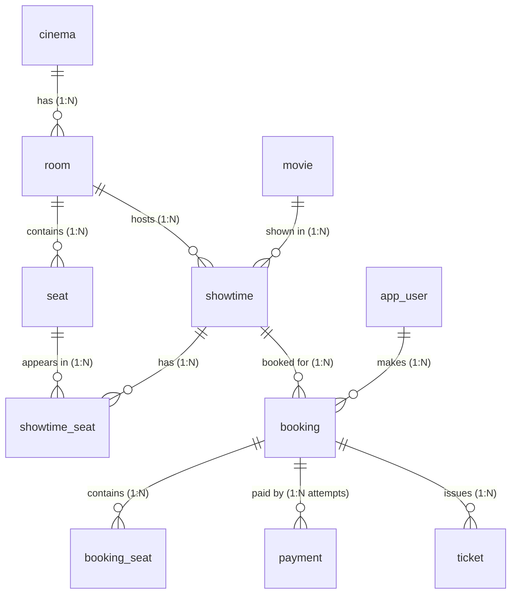

# Mô hình dữ liệu chi tiết (Data Model & Schema Dictionary)

Tài liệu này là **nguồn sự thật duy nhất (Single Source of Truth)** cho cấu trúc Database của dự án. Tất cả changelog Liquibase và Entity JPA phải tuân thủ nghiêm ngặt thiết kế dưới đây.

---

## 1. Quy ước thiết kế chung

* **Hệ quản trị CSDL:** PostgreSQL 17
* **Khóa chính (PK):** Chuẩn hóa cú pháp trực tiếp tại cột: `id BIGSERIAL PRIMARY KEY` (riêng bảng `seat` là `id SERIAL PRIMARY KEY`).
* **Thời gian:** 
  * CSDL luôn lưu chuẩn UTC bằng kiểu `TIMESTAMPTZ`.
  * **Múi giờ rạp:** Toàn bộ hệ thống là một chuỗi rạp duy nhất hoạt động tại Việt Nam, múi giờ hiển thị được coi là hằng số `Asia/Ho_Chi_Minh` (UTC+7) ở tầng ứng dụng (Application Layer). Không tạo thêm cột timezone ở bảng `cinema` để tránh dư thừa.
  * **Ai cập nhật `updated_at`:** Tầng Application (Spring Data JPA) quản lý tự động thông qua `@UpdateTimestamp` / `AuditingEntityListener`. Không dùng Trigger trong DB để giữ schema đơn giản và dễ test.
* **Tiền tệ:** Luôn dùng số nguyên `BIGINT` đơn vị VND (tránh sai số dấu phẩy động của `FLOAT`/`DOUBLE`).
* **Tính toàn vẹn & Lịch sử (Integrity & Soft Delete):**
  * **Không dùng `CASCADE` xóa hàng loạt:** Cấm xóa vật lý đối với `cinema`, `room`, `seat` bằng `ON DELETE RESTRICT` để bảo toàn lịch sử bán vé và báo cáo tài chính.
  * Dùng cờ `is_active BOOLEAN NOT NULL DEFAULT TRUE` để ngừng hoạt động một rạp/phòng/ghế mà không làm gãy các dữ liệu lịch sử liên kết (`ticket`, `showtime_seat`).
* **File lưu trữ (S3/MinIO):** Bảng CSDL chỉ lưu **S3 Object Key** (VD: `posters/2026/avatar2.jpg`), không lưu full domain URL hay presigned URL (vì presigned URL có hạn sử dụng, domain có thể đổi).
* **Quy ước đặt tên Constraint & Index:**
  * **Khóa chính (PRIMARY KEY):** `pk_<tên_bảng>` (hoặc mặc định `<tên_bảng>_pkey` do PostgreSQL tự sinh).
  * **Ràng buộc kiểm tra (CHECK constraint - `chk_`):** `chk_<tên_bảng>_<tên_cột>`. Dùng để kiểm tra tính hợp lệ dữ liệu trực tiếp trong CSDL (giá trị enum, thời lượng số dương `duration_minutes > 0`...).
  * **Khóa ngoại (FOREIGN KEY - `fk_`):** `fk_<bảng_con>_<bảng_cha>`.
  * **Ràng buộc duy nhất (UNIQUE - `uq_`):** `uq_<tên_bảng>_<mô_tả>`.
  * **Chỉ mục (INDEX - `idx_`):** `idx_<tên_bảng>_<mô_tả>`.

---

## 2. Sơ đồ thực thể tổng quan (ERD)



> **Quan hệ `booking` và `payment`:** Là quan hệ **1-N (1:N payment attempts)**. Một đơn đặt vé có thể có nhiều lượt thanh toán thử (lần 1 timeout hoặc lỗi mạng, lần 2 thử lại). Nghiệp vụ bảo đảm: trong số các lần thanh toán, chỉ có tối đa 1 giao dịch ở trạng thái `SUCCESS`.

---

## 3. Phân hệ 1: Nhóm Catalog & Người dùng (Changelog 001)

### 3.1. Bảng `app_user` (Người dùng hệ thống)
* **Nghiệp vụ:** Khách hàng và Admin (UC1). Tên bảng là `app_user` vì `user` là từ khóa dành riêng trong PostgreSQL.

| Tên cột | Kiểu dữ liệu | Nullable | Mặc định | Ý nghĩa & Quy tắc |
| :--- | :--- | :---: | :--- | :--- |
| `id` | `BIGSERIAL` | No | Auto increment | Khóa chính |
| `email` | `VARCHAR(255)` | No | | Email đăng nhập, định danh duy nhất |
| `password_hash` | `VARCHAR(255)` | No | | Mật khẩu băm (BCrypt) |
| `full_name` | `VARCHAR(100)` | No | | Họ tên hiển thị |
| `role` | `VARCHAR(20)` | No | `'CUSTOMER'` | Phân quyền: `CUSTOMER`, `ADMIN` |
| `created_at` | `TIMESTAMPTZ` | No | `CURRENT_TIMESTAMP` | Thời điểm tạo tài khoản (UTC) |
| `updated_at` | `TIMESTAMPTZ` | No | `CURRENT_TIMESTAMP` | Thời điểm cập nhật cuối (UTC) |

* **Ràng buộc & Index:**
  * `PRIMARY KEY (id)`
  * `CONSTRAINT chk_app_user_role CHECK (role IN ('CUSTOMER', 'ADMIN'))`
  * `CREATE UNIQUE INDEX uq_app_user_email ON app_user (LOWER(email));` — Đảm bảo không phân biệt chữ hoa/thường (`A@x.com` và `a@x.com` cùng là một tài khoản).

---

### 3.2. Bảng `movie` (Phim)
* **Nghiệp vụ:** Danh mục phim (UC2, UC9). Trạng thái do Admin quản lý qua API (hoặc scheduled job tương lai).

| Tên cột | Kiểu dữ liệu | Nullable | Mặc định | Ý nghĩa & Quy tắc |
| :--- | :--- | :---: | :--- | :--- |
| `id` | `BIGSERIAL` | No | Auto increment | Khóa chính |
| `title` | `VARCHAR(255)` | No | | Tên phim |
| `duration_minutes` | `INT` | No | | Thời lượng chiếu (phút), dùng để tính giờ kết thúc suất |
| `release_date` | `DATE` | No | | Ngày công chiếu |
| `poster_key` | `VARCHAR(255)` | Yes | | S3 Object Key (VD: `posters/2026/avatar2.jpg`) |
| `status` | `VARCHAR(20)` | No | `'COMING_SOON'` | Trạng thái: `COMING_SOON`, `NOW_SHOWING`, `ENDED` |
| `created_at` | `TIMESTAMPTZ` | No | `CURRENT_TIMESTAMP` | Thời điểm tạo (UTC) |
| `updated_at` | `TIMESTAMPTZ` | No | `CURRENT_TIMESTAMP` | Thời điểm cập nhật cuối (UTC) |

* **Ràng buộc & Index:**
  * `PRIMARY KEY (id)`
  * `CONSTRAINT chk_movie_duration CHECK (duration_minutes > 0)`: Thời lượng phim bắt buộc phải là số dương.
  * `CONSTRAINT chk_movie_status CHECK (status IN ('COMING_SOON', 'NOW_SHOWING', 'ENDED'))`

---

### 3.3. Bảng `cinema` (Cụm rạp)
* **Nghiệp vụ:** Rạp chiếu phim trong chuỗi (UC3, UC9).

| Tên cột | Kiểu dữ liệu | Nullable | Mặc định | Ý nghĩa & Quy tắc |
| :--- | :--- | :---: | :--- | :--- |
| `id` | `BIGSERIAL` | No | Auto increment | Khóa chính |
| `name` | `VARCHAR(255)` | No | | Tên rạp (VD: "CGV Landmark 81") |
| `address` | `VARCHAR(500)` | No | | Địa chỉ rạp |
| `city` | `VARCHAR(100)` | No | | Thành phố / Tỉnh |
| `is_active` | `BOOLEAN` | No | `TRUE` | Trạng thái hoạt động (Soft delete) |
| `created_at` | `TIMESTAMPTZ` | No | `CURRENT_TIMESTAMP` | Thời điểm tạo (UTC) |
| `updated_at` | `TIMESTAMPTZ` | No | `CURRENT_TIMESTAMP` | Thời điểm cập nhật cuối (UTC) |

* **Ràng buộc & Index:**
  * `PRIMARY KEY (id)`

---

### 3.4. Bảng `room` (Phòng chiếu)
* **Nghiệp vụ:** Phòng chiếu thuộc rạp (UC3, UC9). Đã loại bỏ cột `total_seats` để tránh trùng lặp dữ liệu và lệch đồng bộ với bảng `seat`.

| Tên cột | Kiểu dữ liệu | Nullable | Mặc định | Ý nghĩa & Quy tắc |
| :--- | :--- | :---: | :--- | :--- |
| `id` | `BIGSERIAL` | No | Auto increment | Khóa chính |
| `cinema_id` | `BIGINT` | No | | Khóa ngoại trỏ về `cinema(id)` |
| `name` | `VARCHAR(100)` | No | | Tên phòng (VD: "Screen 1", "IMAX") |
| `is_active` | `BOOLEAN` | No | `TRUE` | Trạng thái hoạt động (Soft delete) |
| `created_at` | `TIMESTAMPTZ` | No | `CURRENT_TIMESTAMP` | Thời điểm tạo (UTC) |
| `updated_at` | `TIMESTAMPTZ` | No | `CURRENT_TIMESTAMP` | Thời điểm cập nhật cuối (UTC) |

* **Ràng buộc & Index:**
  * `PRIMARY KEY (id)`
  * `CONSTRAINT fk_room_cinema FOREIGN KEY (cinema_id) REFERENCES cinema (id) ON DELETE RESTRICT`
  * `CONSTRAINT uq_room_cinema_name UNIQUE (cinema_id, name)`: Một rạp không thể có 2 phòng trùng tên.

---

### 3.5. Bảng `seat` (Ghế ngồi)
* **Nghiệp vụ:** Ghế vật lý trong phòng (UC4, UC5).

| Tên cột | Kiểu dữ liệu | Nullable | Mặc định | Ý nghĩa & Quy tắc |
| :--- | :--- | :---: | :--- | :--- |
| `id` | **`SERIAL`** (`INT`) | No | Auto increment | Khóa chính (Tối đa 2.1 tỷ ghế) |
| `room_id` | `BIGINT` | No | | Khóa ngoại trỏ về `room(id)` |
| `seat_row` | `VARCHAR(10)` | No | | Hàng ghế (VD: 'A', 'B', 'VIP') |
| `seat_number` | `INT` | No | | Số ghế trong hàng (1, 2, 3...) |
| `seat_type` | `VARCHAR(20)` | No | `'STANDARD'` | Loại ghế: `STANDARD`, `VIP`, `COUPLE` |
| `is_active` | `BOOLEAN` | No | `TRUE` | Trạng thái ghế (ghế hỏng/bảo trì) |
| `created_at` | `TIMESTAMPTZ` | No | `CURRENT_TIMESTAMP` | Thời điểm tạo (UTC) |

* **Ràng buộc & Index:**
  * `PRIMARY KEY (id)`
  * `CONSTRAINT fk_seat_room FOREIGN KEY (room_id) REFERENCES room (id) ON DELETE RESTRICT`
  * `CONSTRAINT uq_seat_room_row_number UNIQUE (room_id, seat_row, seat_number)`
  * `CONSTRAINT chk_seat_type CHECK (seat_type IN ('STANDARD', 'VIP', 'COUPLE'))`

---

## 4. Ước lượng quy mô số dòng & Dung lượng dữ liệu

Theo quy mô giả định trong `01-requirements.md` (50 rạp, 8 phòng/rạp, 150 ghế/phòng, 6 suất/ngày, lưu 90 ngày):

| Bảng | Tốc độ tăng trưởng | Ước lượng 90 ngày | Dung lượng ước tính | Tần suất đọc / ghi |
|---|---|---|---|---|
| `cinema` | Bán tĩnh | ~50 dòng | < 1 MB | Đọc nhiều (Read-heavy) |
| `room` | Bán tĩnh | ~400 dòng | < 1 MB | Đọc nhiều |
| `seat` | Bán tĩnh | ~60.000 dòng | ~5 MB | Đọc nhiều |
| `movie` | ~10-20 phim/tháng | ~100 dòng | < 1 MB | Đọc rất nhiều (Cache) |
| `showtime` | ~2.400 suất/ngày | ~216.000 dòng | ~30 MB | Đọc/Ghi trung bình |
| `showtime_seat` | **~360.000 dòng/ngày** | **~32.400.000 dòng** | **~2.5 - 3 GB** (kèm index) | **Cực nóng (Hotspot ghi/đọc)** |
| `booking` | ~50.000 - 100.000/ngày | ~4.5 - 9 triệu dòng | ~1 GB | Ghi cao, đọc theo user |
| `ticket` | Theo số ghế đã bán | ~10 - 20 triệu dòng | ~1.5 GB | Ghi cao khi hoàn tất thanh toán |

---

## 5. Thí nghiệm kiểm chứng Căn lề dữ liệu (Tuple Alignment): `INTEGER` vs `BIGINT`

### 5.1. Vấn đề lý thuyết
PostgreSQL căn lề dữ liệu trên đĩa theo bội số 4 hoặc 8 bytes (trên kiến trúc CPU 64-bit).
Nếu bảng có composite key `(showtime_id BIGINT, seat_id INT, status SMALLINT)`:
* Thứ tự các cột quyết định padding byte:
  * `BIGINT` (8 bytes) + `INT` (4 bytes) + `SMALLINT` (2 bytes) = 14 bytes + **2 bytes padding** = 16 bytes payload.
  * Nếu `seat_id` dùng `BIGINT`: 8 + 8 + 2 = 18 bytes + **6 bytes padding** = 24 bytes payload.
  * Trong trường hợp này, mức tiết kiệm thực tế trên mỗi row là **8 bytes** (thậm chí lớn hơn 4 bytes do tránh được padding dài).
* Tuy nhiên, trên Index B-Tree, kích thước index tuple cũng phụ thuộc căn lề header.

### 5.2. Script kiểm chứng thực tế (Chạy trên PostgreSQL thật)
Để xác minh chính xác con số thực tế trước khi kết luận trong báo cáo kiến trúc:

```sql
-- Tạo 2 bảng thử nghiệm
CREATE TABLE test_align_bigint (
    showtime_id BIGINT NOT NULL,
    seat_id BIGINT NOT NULL,
    status SMALLINT NOT NULL,
    PRIMARY KEY (showtime_id, seat_id)
);

CREATE TABLE test_align_int (
    showtime_id BIGINT NOT NULL,
    seat_id INT NOT NULL,
    status SMALLINT NOT NULL,
    PRIMARY KEY (showtime_id, seat_id)
);

-- Chèn 1 triệu dòng vào mỗi bảng
INSERT INTO test_align_bigint
SELECT s, g, 0 
FROM generate_series(1, 10000) s, generate_series(1, 100) g;

INSERT INTO test_align_int
SELECT s, g, 0 
FROM generate_series(1, 10000) s, generate_series(1, 100) g;

-- So sánh dung lượng thực tế
SELECT 
    'BIGINT' as variant,
    pg_size_pretty(pg_relation_size('test_align_bigint')) AS table_size,
    pg_size_pretty(pg_total_relation_size('test_align_bigint') - pg_relation_size('test_align_bigint')) AS index_size,
    pg_size_pretty(pg_total_relation_size('test_align_bigint')) AS total_size
UNION ALL
SELECT 
    'INTEGER' as variant,
    pg_size_pretty(pg_relation_size('test_align_int')) AS table_size,
    pg_size_pretty(pg_total_relation_size('test_align_int') - pg_relation_size('test_align_int')) AS index_size,
    pg_size_pretty(pg_total_relation_size('test_align_int')) AS total_size;
```

---

## 6. Thiết kế Key Redis

Redis được dùng từ MVP1 để giữ ghế tạm thời (hold) và cache danh mục.

| Key Format | Kiểu dữ liệu | TTL | Mục đích |
|---|---|---|---|
| `hold:{showtimeId}:{seatId}` | `String` (giá trị là `holdId`) | 480 giây (8 phút) | Khóa giữ ghế nguyên tử qua Lua script. Hết hạn tự nhả. |
| `catalog:movies:now-showing` | `String` (JSON) | 300 giây (5 phút) | Cache danh sách phim đang chiếu trang chủ. |
| `catalog:showtimes:{movieId}:{date}` | `String` (JSON) | 120 giây (2 phút) | Cache danh sách suất chiếu của phim theo ngày. |

---

## 7. Bảng tổng hợp các Quyết định thiết kế (Design Decisions)

| Hạng mục | Lựa chọn | Phương án thay thế | Lý do & Đánh đổi |
|---|---|---|---|
| **seat.id** | `SERIAL` (INTEGER 4 bytes) | `BIGSERIAL` (8 bytes) | Tiết kiệm hàng chục MB đến hàng trăm MB đĩa/RAM khi nhân lên 32 triệu dòng `showtime_seat`. Đánh đổi: phòng không thể có quá 2.1 tỷ ghế (thực tế chỉ 60k). |
| **Xóa dữ liệu danh mục** | `RESTRICT` + `is_active` (Soft delete) | `CASCADE` (Hard delete) | Tránh vô tình xóa nhầm dữ liệu lịch sử đặt vé (`ticket`, `showtime_seat`) khi bảo trì rạp/phòng. |
| **Độ dài và ký hiệu email** | `LOWER(email)` Unique Index | `CITEXT` extension hoặc phân biệt hoa thường | Tránh tạo 2 tài khoản trùng nhau chỉ vì gõ chữ hoa/thường; không cần bật extension ngoài `citext`. |
| **Ảnh poster** | Lưu S3 Object Key (`poster_key`) | Lưu Full URL hoặc Base64 | Độc lập với domain/CDN bên ngoài; dễ dàng đổi bucket hoặc sinh presigned URL theo yêu cầu bảo mật. |
| **Trạng thái ghế đang giữ** | Lưu tại **Redis** (TTL 8 phút) | Lưu tại bảng `showtime_seat` | Tránh ghi liên tục vào Postgres khi hàng nghìn người click giữ/nhả ghế; Redis tự động dọn dẹp bằng TTL mà không cần DB cleanup job liên tục. |
