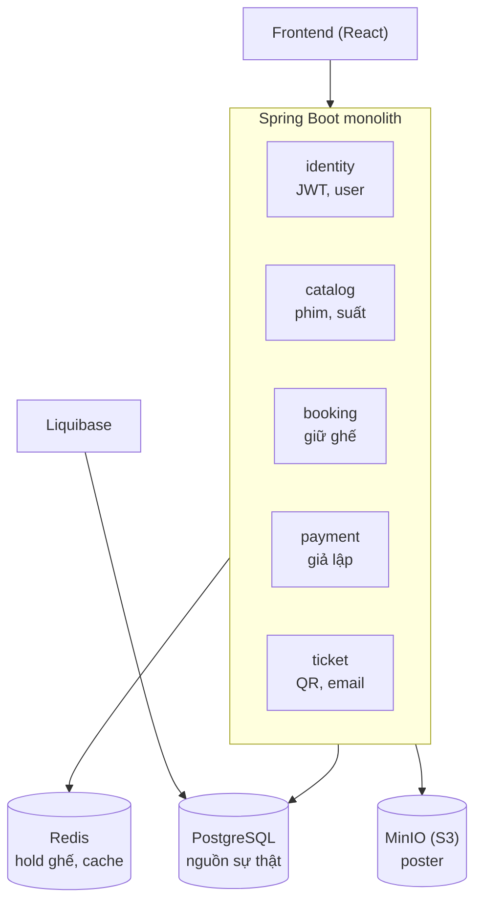
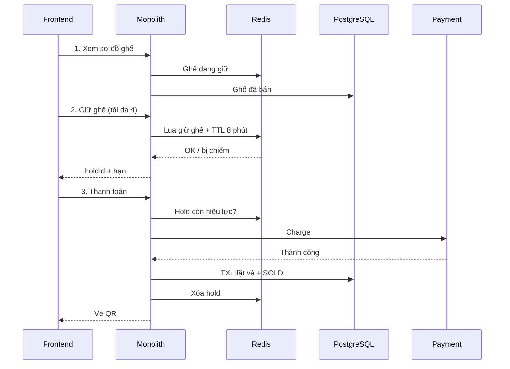
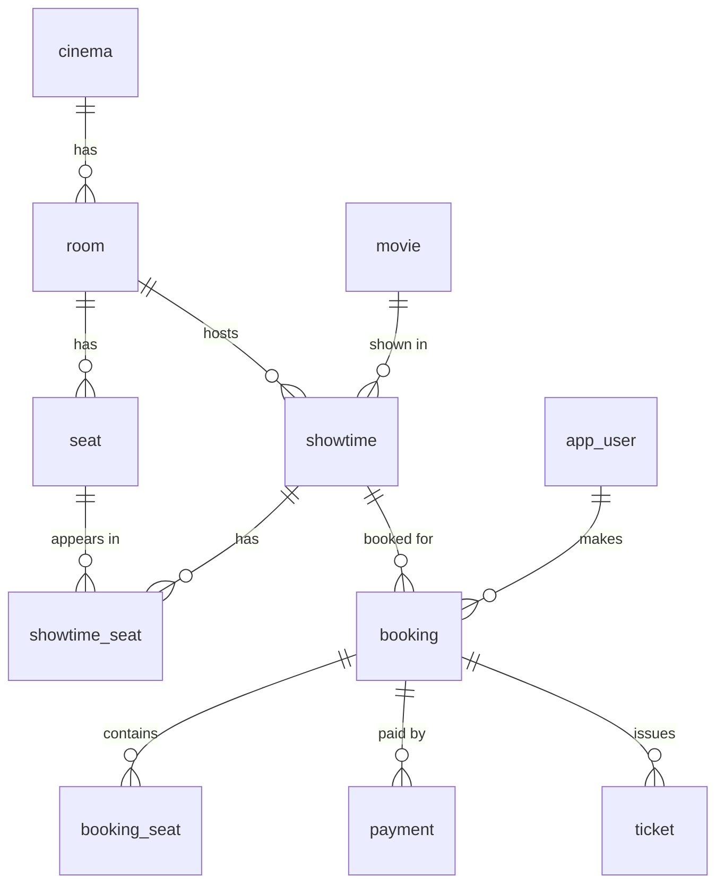
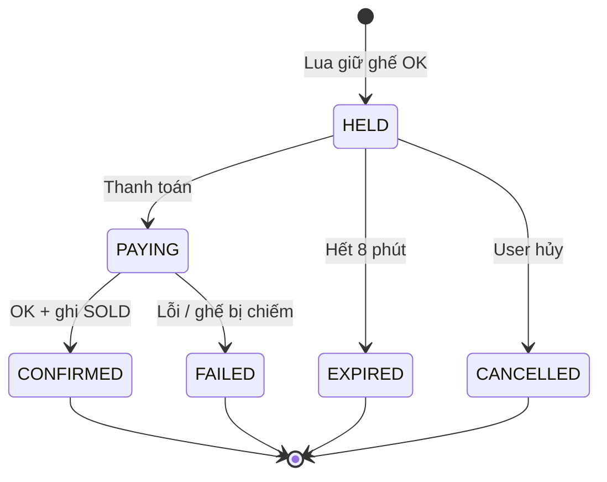
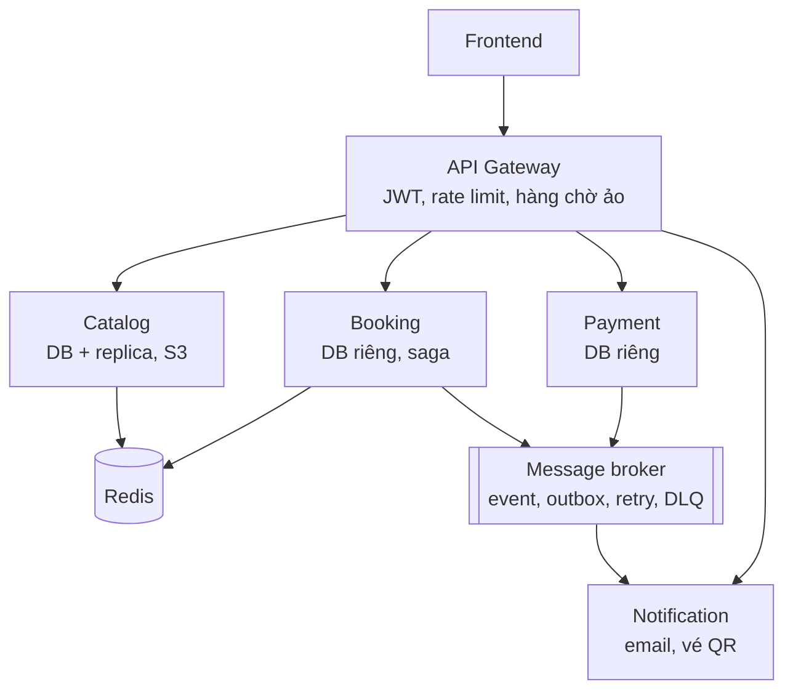

# Dự án bán vé xem phim: tổng hợp tiến độ

> Tài liệu này tóm tắt những gì đã chốt trong các buổi brainstorm để bạn catch up nhanh.
> Phần "Việc của bạn" ở cuối là nơi bạn tiếp tục. Bạn tự viết, mình chỉ hướng dẫn và review.

## 1. Mục tiêu và cách học

- Mục tiêu: học Java/Spring Boot và kiến thức backend (caching Redis, message queue, replica, load balancing, S3, database, microservice) qua **một dự án duy nhất**, nâng cấp dần.
- Đây là "phòng lab", không phải sản phẩm thật. Không cần user thật vì áp lực được **giả lập** bằng load test (k6/JMeter), seed dữ liệu lớn, giới hạn tài nguyên Docker và gây lỗi chủ động.
- Quy tắc chống over-engineering: **trigger trước, công nghệ sau**. Chỉ thêm một thành phần (cache, queue, replica...) khi đo được vấn đề mà nó giải quyết. Không đo ra được thì không thêm, và đó cũng là một bài học.
- Microservice: **không bắt đầu bằng microservice**. Làm modular monolith trước, chịu đau, rồi tách dần ở MVP2.

## 2. Đề tài và quyết định nghiệp vụ đã chốt

| Quyết định | Chốt |
|---|---|
| Đề tài | Bán vé xem phim, **một chuỗi rạp duy nhất** (không làm marketplace nhiều đối tác) |
| Số ghế tối đa mỗi lần đặt | **4** |
| Hết thời gian giữ ghế | Hết session, ghế được **nhả** cho người khác (không gia hạn) |
| Thời gian giữ ghế | 8 phút (TTL) |
| Hoàn vé | **Không làm** |
| Redis | Dùng **ngay từ MVP1** để giữ ghế |
| Công nghệ | Java 21, Spring Boot, PostgreSQL, Redis, MinIO (S3), **Liquibase**, Docker Compose |
| Ràng buộc cứng duy nhất | **Không bao giờ bán trùng một ghế** |

Luồng khách hàng: xem phim → chọn rạp/suất chiếu → xem sơ đồ ghế → giữ ghế → thanh toán → nhận vé QR.
Quản trị: quản lý phim, rạp, phòng, suất chiếu, giá vé, upload poster.

## 3. Quy mô giả định (để giả lập)

- 50 rạp x 8 phòng = 400 phòng; 6 suất/ngày; 150 ghế/phòng.
- ~2.400 suất/ngày, **~360 nghìn dòng `showtime_seat` mỗi ngày**.
- Seed lịch sử 90 ngày: **~32 triệu dòng** (~3 GB kèm index). Đủ để thấy tác dụng của index và partition. Chỉ lên 1 năm nếu muốn thử partition thật sự.
- Bình thường ~50 RPS; đỉnh lúc mở bán bom tấn: 20 nghìn người trong vài chục giây, dồn vào ~20 suất chiếu.
- Mục tiêu tham khảo: sơ đồ ghế p95 < 300ms.

## 4. Hai MVP

| | MVP1: Đúng đắn | MVP2: Chịu tải và phân tán |
|---|---|---|
| Kiến trúc | Modular monolith | 4-5 service + gateway |
| Giữ ghế | Redis (Lua, TTL) | Redis (như MVP1) + hàng chờ ảo, rate limit |
| Nguồn sự thật ghế đã bán | PostgreSQL | PostgreSQL |
| Bất đồng bộ | Không | Message broker + outbox |
| Giao dịch | 1 transaction DB | Saga + idempotency |
| Realtime sơ đồ ghế | Polling | SSE |
| Dữ liệu | Index, partial index | Partition, read replica, nhiều instance sau Nginx |
| Trọng tâm học | DB, transaction, index, Liquibase, Redis | Queue, replica, LB, resilience, tracing |

**Tiêu chí hoàn thành MVP1:** zero bán trùng dưới tải test (500 request song song tranh 10 ghế), giữ ghế hết hạn đúng, `docker compose up` dựng được cả hệ thống, có ghi chép số đo trước/sau cho mỗi tối ưu.

**MVP2 chỉ bắt đầu khi** đo được giới hạn thật của MVP1.

## 5. Kiến trúc MVP1

Các module chỉ gọi nhau qua interface (service), không truy cập repository của nhau, để sau này tách service không phải làm lại.

## 6. Luồng đặt vé MVP1

Những điểm quan trọng:

- **Giữ ghế all-or-nothing:** một Lua script chạy nguyên tử trong Redis, đặt tối đa 4 key bằng `SET NX`. Thiếu một ghế thì không đặt ghế nào.
- **Thứ tự an toàn:** ghi `SOLD` vào Postgres **trước**, xóa hold ở Redis **sau**. Nhờ vậy không có khoảng hở nào mà ghế vừa không có hold vừa chưa `SOLD`.
- **Hold hết hạn đúng lúc đang thanh toán:** ghế có thể bị người khác giữ trong khi tiền đã trừ. Lưới an toàn là câu `UPDATE` có điều kiện trên `showtime_seat`; nếu thất bại thì hủy giao dịch thanh toán (void) và báo lỗi. Đây không phải tính năng hoàn vé, chỉ là xử lý lỗi của giao dịch chưa hoàn tất.
- **Redis chết hoặc mất dữ liệu:** các hold biến mất và hai người có thể cùng thanh toán một ghế. Lưới an toàn phía Postgres sẽ chặn người thứ hai.

## 7. Mô hình dữ liệu MVP1

Chín bảng + `app_user`. Các quyết định thiết kế đáng nhớ:

- **`showtime_seat` là bảng nóng nhất.** Khóa chính `(showtime_id, seat_id)`, chỉ có hai trạng thái: `0` = AVAILABLE, `1` = SOLD. Trạng thái "đang giữ" nằm ở Redis, không nằm ở đây.
- **Lưới an toàn chống bán trùng, hai lớp:**
  1. `UPDATE showtime_seat SET status = 1 ... WHERE status = 0`, rồi kiểm tra số dòng bị ảnh hưởng đúng bằng số ghế.
  2. `ticket` có `UNIQUE (showtime_id, seat_id)`.
- `showtime_seat` **cố ý không có khóa ngoại** để seed/ghi nhanh; tính toàn vẹn do app đảm bảo. Đây là một đánh đổi bạn có thể tự đo lại.
- `seat.id` dùng `INTEGER` (không phải `BIGINT`) vì nó lặp lại hàng chục triệu lần trong `showtime_seat`.
- `booking` lưu `hold_id`, `expires_at`, `idempotency_key` (UNIQUE theo user) và có partial index cho job dọn booking hết hạn.
- Thời gian lưu **UTC** (`TIMESTAMPTZ`), hiển thị theo giờ rạp ở tầng app. Tiền VND dùng số nguyên.
- Bảng người dùng tên `app_user` vì `user` là từ khóa dành riêng của Postgres.
- Suất chiếu có exclusion constraint chặn hai suất trùng giờ trong cùng một phòng (tùy chọn, có thể bỏ ở giai đoạn đầu).

### Thiết kế key Redis

| Key | Giá trị | TTL |
|---|---|---|
| `hold:{showtimeId}:{seatId}` | `holdId` | 480 giây |

Khi thanh toán, app kiểm tra key còn tồn tại và giá trị đúng bằng `holdId` của mình rồi mới đi tiếp.

## 8. State machine của booking

| Từ | Sang | Khi nào | Ai kích hoạt |
|---|---|---|---|
| (mới) | `HELD` | Lua script giữ ghế thành công | API giữ ghế |
| `HELD` | `PAYING` | Bấm thanh toán, hold còn hiệu lực | API thanh toán |
| `HELD` | `EXPIRED` | Quá `expires_at` | Job dọn nền, hoặc phát hiện lười khi người dùng quay lại |
| `HELD` | `CANCELLED` | Người dùng bỏ đặt vé | API hủy |
| `PAYING` | `CONFIRMED` | Thanh toán thành công và ghi `SOLD` thành công | API thanh toán |
| `PAYING` | `FAILED` | Thanh toán lỗi, hoặc hold mất khiến ghi `SOLD` thất bại (kèm void) | API thanh toán |

Hai quy tắc: **trạng thái cuối không bao giờ đổi nữa**, và mỗi lần chuyển trạng thái dùng `UPDATE ... WHERE status = '<trạng thái cũ>'` để hai request song song không ghi đè nhau.

## 9. Kiến trúc MVP2 (định hướng, chưa chi tiết hóa)

- **Booking giữ cả ghế lẫn đơn đặt vé.** Ranh giới service theo tính nhất quán dữ liệu, không chỉ theo tên nghiệp vụ. Tách ghế ra riêng sẽ buộc xử lý giao dịch phân tán ở thao tác nhạy cảm nhất mà ít học thêm.
- Ticket (sinh QR) gộp vào Booking; Notification chỉ gửi email.
- **Mỗi service một database riêng và một changelog Liquibase riêng.** Không join chéo, không service nào chạy migration lên DB của service khác.
- Thứ tự tách, dễ đến khó: Notification, Catalog, Payment, Booking.
- Outbox: ghi `SOLD` và bản ghi event trong **cùng một transaction**, một relay đẩy lên broker. Consumer phải idempotent (at-least-once).
- Saga: Booking làm orchestrator (dễ debug hơn), có nhánh bù trừ khi Payment lỗi.

## 10. Liquibase: quy ước đã chốt

- Viết changeset bằng **formatted SQL** (không dùng YAML/XML) để thấy rõ những gì mình học.
- `spring.jpa.hibernate.ddl-auto: validate`. Liquibase là nguồn sự thật duy nhất của schema.
- **Không bao giờ sửa changeset đã áp dụng**, chỉ thêm changeset mới.
- Seed lớn gắn `context: loadtest`, hoặc chạy bằng script `generate_series` ngoài, không để migration thường chạy seed.
- Index trên bảng lớn dùng `CREATE INDEX CONCURRENTLY` với `runInTransaction:false`.
- Mỗi changeset có `--rollback`.

## 11. Đã có gì, chưa có gì

**Đã có (đáp án tham khảo từ mình, không phải bài làm của bạn):**

- Sơ đồ kiến trúc MVP1 và MVP2, sequence diagram, ERD, state machine (trong cuộc trò chuyện và trong file này).
- Bộ changelog Liquibase v0: `db.changelog-master.yaml` và 4 file `001`-`004` (đã kiểm tra cú pháp bằng parser Postgres, **chưa chạy thử trên Postgres thật**).
- Một bản nháp script seed 90 ngày. Lưu ý: nó viết theo schema cũ nên **cần bạn tự phát hiện và sửa khi chạy thử** (đây cũng là một bài tập).

**Chưa có:**

- `` trong repo của bạn, và code Spring Boot.
- Danh sách API, SLO + tiêu chí nghiệm thu, bảng failure mode, luồng check-in tại rạp (QR ký chữ ký, vé dùng một lần), các ADR.

## 12. Việc của bạn: tiếp tục từ đây

Thỏa thuận làm việc: **bạn viết, mình hướng dẫn và review.** Hãy dán bản nháp vào cuộc trò chuyện, mình sẽ chỉ ra chỗ thiếu hoặc chưa chặt, không viết lại hộ.

Mỗi bước là một file trong `` của repo:

1. **`01-requirements.md`**: ai dùng hệ thống và làm gì (5-6 use case)? Ràng buộc nào tuyệt đối không được vi phạm? Quy mô giả định (tự tính lại 360 nghìn dòng/ngày)? Hai con số p95 bạn muốn đạt?
2. **`03-data-model.md`**: tự vẽ ERD trước, rồi tự viết lại changelog 001-004 mà **không nhìn** file của mình, sau đó so sánh và tự hỏi "vì sao mình làm khác?". Với mỗi bảng: khóa chính là gì, cần unique ở đâu, cột nào bị lọc nhiều thì cần index?
3. **Bảng state machine** của riêng bạn. Câu hỏi dẫn dắt: nếu hai request thanh toán cùng một booking đến cùng lúc thì chuyện gì xảy ra?
4. **`05-failure-modes.md`**: bảng ba cột *sự cố / hệ thống phản ứng thế nào / làm sao kiểm chứng*, tối thiểu 6 dòng. Bắt đầu từ: Redis chết, payment timeout, hold hết hạn lúc đang trả tiền, request bị gửi trùng.
5. **ADR**: 3 cái đầu, mỗi cái 5-8 dòng (bối cảnh, lựa chọn, đánh đổi): vì sao hold ở Redis, vì sao Booking giữ cả ghế, vì sao chọn Liquibase.
6. Sau khi xong 1-5, làm tiếp: **danh sách API**, **SLO và tiêu chí nghiệm thu**, **luồng check-in**.
7. Chỉ khi các tài liệu trên đủ dùng, mới dựng project Spring Boot + Docker Compose (Postgres, Redis, MinIO) và chạy Liquibase lần đầu.

**Bài tập nhỏ khi dựng xong DB:** chạy thử script seed, đọc thông báo lỗi và tự tìm nguyên nhân (gợi ý: nhìn các `CHECK` của bảng `showtime_seat`).

## 13. Hoãn đến MVP2

Hàng chờ ảo và rate limit chi tiết, sơ đồ triển khai nhiều instance/replica/load balancer, chiến lược partition và vòng đời dữ liệu, realtime bằng SSE, tracing/metrics/chaos test, lộ trình tách monolith.
